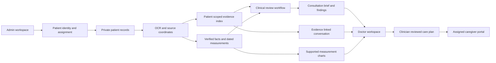

# PrepPulse

Patient privacy: external text AI requests pseudonymize registered identifiers before transmission; the deployed disks and backups are encrypted. Read the [privacy controls, verification and limits](documentation/PATIENT_PRIVACY.md), including the cloud dictation exception and local storage requirements.

The [7 November privacy verification](documentation/PRIVACY_VERIFICATION_2026_11_07.md) records the encrypted restore, 15 document real provider rehearsal, outgoing payload checks and live browser test.

Processing progress, provider availability checks, Upcoming appointments and administrator deletion are described in [Processing and maintenance](documentation/PROCESSING_AND_MAINTENANCE.md).

The latest [release verification](documentation/RELEASE_VERIFICATION_2026_11_06.md) records the fresh patient ingestion, chat, chart, translation and cleanup checks and the current Azure fallback limitation.

**Use the deployed PrepPulse website:** [Open PrepPulse](https://preppulse-pilot-b8bc.centralindia.cloudapp.azure.com/)

PrepPulse is a physician assistance workspace for reviewing a patient's longitudinal health record. It brings years of uploaded reports, laboratory results, consultations, admissions, appointments and signed care plans into a connected view. The doctor can orient quickly with a structured summary, follow a dated history, inspect supported measurements, ask evidence-based questions and open the original page behind a cited finding.

PrepPulse helps reduce the effort of reading a large record. It does not hide the record, make a diagnosis, or replace a clinician's judgment. Generated summaries and suggestions remain assistive. Findings link back to patient-scoped evidence so the doctor can verify them in context.

Structured extraction keeps a source-linked review queue for model output that cannot be safely interpreted as a single numeric result. A malformed reading does not stop the rest of a patient's uploaded documents from being processed.

## Product at a glance

An administrator registers patients and accounts, assigns doctors and caregivers, and manages appointments. Doctors work from Today and Patients, analyze records, inspect cited findings, review prior visits, ask questions in a saved patient conversation, and prepare a clinician-reviewed family or caregiver plan. Caregivers can see only plans assigned to them, report checklist completion and share notes. Patient records, appointment history, conversation artifacts, source files and signed plans persist in the deployed database and private storage.

Administrators can search the patient directory and find patients by name, permanent ID or folder alias when scheduling appointments. Caregivers can search their assigned care plans by patient name or ID.

The web client is served over HTTPS from the Azure-hosted application. It calls the authenticated FastAPI service through the same site origin. The service stores structured records and durable work in MongoDB, stores private files on persistent storage, and runs clinical and care processing in separate workers.

## Deployed technology stack

| Area | Technology in this deployed product |
| --- | --- |
| User interface | React, TypeScript, Vite, responsive CSS and Recharts |
| Web delivery | Caddy, HTTPS and same-origin API routing |
| Hosting | Azure Ubuntu virtual machine, Docker Compose and persistent managed disk |
| Application API | Python 3.11 and FastAPI |
| Durable state | MongoDB 8, indexed patient and workflow collections, leased background jobs |
| Private files | Persistent disk, authenticated patient-scoped document routes and encrypted Azure Blob backups |
| OCR and document handling | PyMuPDF, Tesseract, page rendering and normalized source coordinates |
| Retrieval | Patient-scoped lexical and semantic retrieval with source metadata and ranked evidence |
| Clinical orchestration | LangGraph review workflow with structured outputs and validation |
| Clinical language model | Sarvam `sarvam-105b` as the configured primary provider |
| Secondary clinical model | Azure OpenAI adapter; live model deployment is currently blocked by an Azure subscription restriction |
| Translation and dictation | Azure AI Translator and Azure AI Speech, with configured service fallback |
| Embeddings | Pinned multilingual E5-small model executed by the application on CPU |
| Healthcare exchange | FHIR R4 validation and persisted, versioned resources |
| Identity and secrets | Role and patient authorization, protected sessions, Azure Key Vault and VM managed identity |

The deployed service is currently available at the link above. Sarvam is the working clinical LLM provider. Azure OpenAI has been provisioned as an adapter, but Azure rejected the pilot model deployment; a working Azure LLM fallback is therefore not claimed. Current deployment observations and test limits are recorded in the [verification report](deployment/VERIFICATION.md).

## How the product works

An upload is stored as a private patient document and processed as a visible job. OCR and extraction retain page and location provenance. Retrieval supplies scoped evidence to the model, while deterministic validation checks structured clinical outputs and chart values. The doctor reviews the result and can open the source preview. Care plans require clinician review and sign-off before they become caregiver instructions.

## AI components

The deployed clinical review graph has eight stages. Each stage contributes a bounded part of the review; no stage independently diagnoses or prescribes.

| Component | Purpose |
| --- | --- |
| Classification agent | Organizes documented diabetes status and supporting record evidence for review. |
| Trajectory agent | Summarizes dated metabolic measurements and changes found in the records. |
| Care gaps agent | Identifies possible missing or overdue follow-up for clinician confirmation. |
| Mismatches agent | Surfaces conflicting dates, values or medication details for reconciliation. |
| Comorbidities agent | Collects relevant documented non-diabetes history and context. |
| Caregiver preparation agent | Drafts general, understandable handoff reminders grounded in the record. |
| Assistive bubbles agent | Produces concise review prompts for the workspace. |
| Brief compiler | Validates and combines stage outputs into the consultation brief contract. |

Retrieval combines lexical search with multilingual semantic embeddings. Chat answers cite turn-specific retrieved evidence. Charts use dated, verified measurement observations rather than values invented by a language model. Supported plotted series are HbA1c, fasting glucose, post-meal glucose, eGFR, urine ACR, creatinine, LDL cholesterol, systolic blood pressure and diastolic blood pressure. Other conditions can be summarized from records and shown in evidence-linked tables, but unsupported measurements are not charted.

## Workspaces

| Workspace | What it supports |
| --- | --- |
| Patients | Consultation brief, history, priority findings, assistant, source proof, checklist, upload and visit actions |
| Today | Doctor's appointments for the current date and patient navigation |
| Records | Patient records, dated visits, original documents, signed plans and historical review |
| Care pathways | Editable checklist, clinician notes, prescription schedule, translation, review and sign-off |
| New patient intake | Patient registration and document intake |
| Patient appointments | Scheduling, Today and Upcoming views, date filters and prior appointment search |
| Patient directory | Patient details, assignment, appointments and records administration |
| Accounts | Doctor, administrator and caregiver account management and access assignment |
| Caregiver portal | Assigned plans, selected-language view, daily checklist reporting and notes |
| Settings | Display preferences and administrator-controlled deployed AI routing |

## Documentation

Start with the focused guides below. The detailed Azure procedures and factual release results remain in the deployment runbook and verification report.

| Guide | Coverage |
| --- | --- |
| [Product overview](docs/product/PRODUCT_OVERVIEW.md) | Product purpose, roles and clinical boundaries |
| [Architecture](docs/product/ARCHITECTURE.md) | Deployed runtime, data flow, persistence and trust boundaries |
| [Frontend](docs/product/FRONTEND.md) | Doctor, administrator and caregiver pages and responsive behavior |
| [Backend](docs/product/BACKEND.md) | API, identity, database, files and durable workers |
| [AI and retrieval](docs/product/AI_AND_RAG.md) | Providers, agents, retrieval, citations, charts, translation and dictation |
| [Setup and operations](docs/product/SETUP.md) | Azure prerequisites, configuration, release, backup and recovery |
| [Azure deployment runbook](deployment/README.md) | Detailed deployed environment, operating procedures and limitations |
| [Release verification](deployment/VERIFICATION.md) | Checks performed, results, exclusions and remaining issues |

## Open the product

Visit [PrepPulse](https://preppulse-pilot-b8bc.centralindia.cloudapp.azure.com/) and sign in with an account provisioned by the administrator. Public account registration is disabled. The current service uses synthetic demonstration data and is not certified for real patient records. Review the [security and operational limitations](deployment/README.md#security-and-next-steps) before handling sensitive information.
