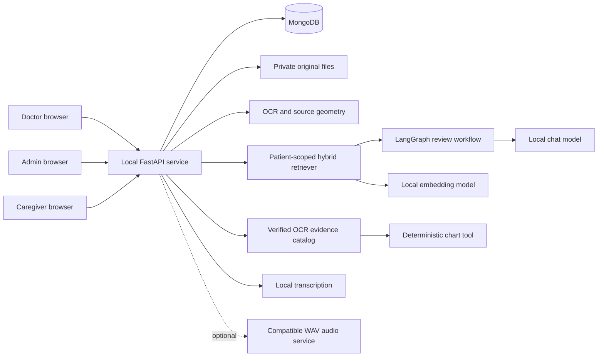
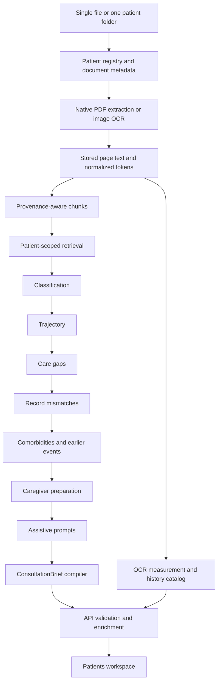

# PrepPulse

## ui_testing - local rehearsal for API deployment

### Technology stack

| Layer | This branch |
| --- | --- |
| Browser | React 18, TypeScript, Vite, Recharts, Markdown/GFM; existing doctor/admin/caregiver interfaces |
| API | Python 3.11+, FastAPI/Uvicorn, authenticated sessions and patient assignment checks |
| Persistence | MongoDB; separate `preppulse_ui_testing*` databases, isolated source-file copies, private SQLite API-budget and embedding caches |
| Primary generation | Sarvam `sarvam-105b`, OpenAI-compatible HTTP interface; reasoning disabled for complete structured replies |
| Google comparison | `gemini-3.5-flash-lite`; the supplied project's actual generation requests reject Gemini 2.5 Flash as unavailable to new users |
| Optional local generation | Existing LM Studio connection; usable only while reachable |
| Retrieval | BM25 plus Python CPU `intfloat/multilingual-e5-small`, pinned revision `614241f622f53c4eeff9890bdc4f31cfecc418b3`, 384 dimensions |
| Clinical workflow | Eight-node LangGraph review, declared prompt output contracts, source-linked evidence catalogue, resumable failed-node checkpoints |
| OCR | Existing native PDF extraction / PyMuPDF, Tesseract and normalized source geometry |
| Structured records | Grounded Stage 2 entities and FHIR R4 transaction bundles validated against the vendored official 4.0.1 base JSON schema |
| Translation | Sarvam Translate, protected clinical values, a validated Sarvam translation-repair attempt, then optional local IndicTrans2 |
| Voice | Sarvam Bulbul v3 read-aloud and Saaras v3 transcription; compatible local fallbacks remain configurable |
| Hosting | **Not deployed.** Oracle/Atlas/private object storage remain a subsequent, separately approved deployment phase |

This branch is an isolated synthetic-data deployment rehearsal. `UI` remains the local-model implementation; `main` is unchanged. Nothing here automatically migrates either the original database or original uploaded files. The detailed project/page guide below describes the inherited application; use this section for the API rehearsal's changed setup and model behaviour.

### Start the isolated demonstration

Existing installation, from the repository root in PowerShell:

```powershell
git switch ui_testing
.\.venv\Scripts\python.exe -m pip install -e ".[dev,deployment-test]" --extra-index-url https://download.pytorch.org/whl/cpu
.\.venv\Scripts\python.exe scripts/download_embeddings.py
# Once only; refuses to overwrite an existing test database:
.\.venv\Scripts\python.exe scripts/prepare_ui_testing.py
.\.venv\Scripts\python.exe scripts/prepare_ui_testing.py --database preppulse_ui_testing_gemini
# Start API in this terminal:
.\scripts\run_ui_testing.ps1 -Provider sarvam
```

In a second terminal:

```powershell
cd web
npm ci
$env:PREPPULSE_API_TARGET = "http://127.0.0.1:8001"
node .\node_modules\vite\bin\vite.js --host 127.0.0.1 --port 5174 --strictPort
```

Open `http://127.0.0.1:5174`. The API runs at `http://127.0.0.1:8001`, with API documentation at `/docs`; patient routes require authentication. Copied accounts retain their existing passwords. The rehearsal uses a separate session cookie, database and file root, so signing in need not replace the original workspace session.

For a fresh clone, first create a Python 3.11+ virtual environment and install the dependencies above. MongoDB must be running. Source datasets, downloaded model weights, secrets and private patient records are deliberately absent from Git. If the original database is empty, preparation creates the isolated profile without accounts: bootstrap an administrator with `PREPPULSE_MONGO_DB=preppulse_ui_testing`, then create doctor/caregiver accounts and import a synthetic patient through intake. See the original bootstrap instructions later in this README; run them against the isolated database, never an unintended database. Prepare a matching Google comparison database after synthetic data is available.

The server reads the repository's private `.env`; environment variables explicitly set by the launch script take precedence. Required key names are:

```dotenv
SARVAM_AI_CREDITS_ACC_1=
SARVAM_AI_CREDITS_ACC_2=
SARVAM_AI_CREDITS_ACC_3=
Gemini_free_api_keys=
```

Use [.env.ui_testing.example](.env.ui_testing.example) for non-secret configuration examples. Never put these keys in `VITE_*` variables or frontend code. No keys or clinical test outputs are committed.

### Compare providers under controlled conditions

```powershell
.\.venv\Scripts\python.exe -u scripts/rehearse_providers.py --provider sarvam --stage analyze --fresh-ocr
.\.venv\Scripts\python.exe -u scripts/rehearse_providers.py --provider gemini --stage analyze --fresh-ocr
.\.venv\Scripts\python.exe -u scripts/rehearse_providers.py --provider sarvam --stage chat
.\.venv\Scripts\python.exe -u scripts/rehearse_providers.py --provider gemini --stage chat
.\.venv\Scripts\python.exe -u scripts/rehearse_providers.py --provider sarvam --stage translation
.\.venv\Scripts\python.exe -u scripts/rehearse_providers.py --provider sarvam --stage speech
```

`--fresh-ocr` removes only the chosen synthetic patient's processed OCR and current brief in the isolated provider database, then reprocesses its copied originals. It does not remove original files, signed pathways, original-workspace records or FHIR version archives. Omit it for resumable retries. The default comparison alias is `PP001`. Both providers use matching file hashes and the same pinned Python embedding model. Forced `sarvam` and `gemini` comparisons cannot silently fall back to each other.

Reports and synthetic responses are stored in ignored `.tmp/ui_testing/results/`; generated PDFs are in `.tmp/ui_testing/translation-smoke/`. Provider comparison is an engineering check, not a clinical evaluation or certification. Numeric chart construction still uses verified OCR measurements, not model-invented coordinates or numbers. Broad history answers now receive every verified point for requested metrics so older laboratory values are not displaced by boilerplate retrieval hits.

### Routing, credit pools and limits

- `PREPPULSE_AI_PROVIDER=sarvam|gemini|auto|local|mock` selects generation. `mock` is for explicit offline tests only.
- `auto` tries eligible Sarvam accounts, optionally Gemini when `PREPPULSE_GEMINI_ENABLED=1`, then a reachable local model. Default rehearsal launch explicitly selects Sarvam. Google remains opt-in; independent comparisons are forced-provider runs.
- To demonstrate the approved three-provider order with synthetic data, run `.\scripts\run_ui_testing.ps1 -Provider auto -EnableGemini`. To inspect Google's independently generated records, use `.\scripts\run_ui_testing.ps1 -Provider gemini -Database preppulse_ui_testing_gemini`. Stop the test API before changing its provider/database; the same browser URL can then be reused.
- `PREPPULSE_SYNTHETIC_ONLY=1` is required for this branch's Gemini adapter. This is an operator declaration, not automated de-identification. Do not upload real patient data to a synthetic rehearsal. Google's current API terms restrict sensitive information on unpaid services and prohibit clinical-practice use: [official terms](https://ai.google.dev/gemini-api/terms).
- A model being listed by Google's model API does not establish eligibility. Actual Gemini 2.5 Flash generation returned HTTP 404 for the supplied project; the documented replacement was tested instead. Daily/minute/token limits must be read from the actual project dashboard.
- Sarvam balances belong to **organisations**, not keys. Keys in one organisation share a wallet. Map their `SARVAM_ACC_n_POOL` values accordingly. Identical keys are deduplicated.
- No documented programmatic credit-balance endpoint was confirmed. Optional `SARVAM_ACC_n_STARTING_CREDITS` values therefore seed an **estimate**, not a live dashboard balance. Spending outside this application makes the estimate stale. With a known starting balance the router reserves the estimated request cost and skips a pool before it would fall below 10. Unknown balances remain unknown; explicit insufficient-credit responses trigger account cooldown/rotation.
- Rate-limit responses do not trigger Sarvam key rotation to evade the limit. Authentication/availability failures, empty replies and truncated structured responses are visible errors, with bounded eligible-provider fallback.
- API calls reserve estimated spending in private `api_usage.sqlite3` before dispatch, across processes. This survives restarts and protects concurrent requests. Configured estimates are not a provider invoice; server-reported token usage refines chat estimates, while translation/audio retain conservative reservations.
- The initial Sarvam test ceiling is INR 50. The owner subsequently authorised additional testing as needed; the rehearsal launcher uses a bounded 200-attempt Google counter. The ledger retains all attempts, including failures. A filled ledger stops further calls; do not delete it to hide usage. Estimates and Google token counts do not establish the dashboard's actual billed amount or remaining credit balance.
- Local fallback cannot work when the PC/model server is off or unreachable from a future hosted backend.

### FHIR, provenance and resumability

`PREPPULSE_FHIR_ENABLED=1` connects browser analysis to Stage 2 extraction and Stage 3 rendering. Cloud extraction groups one document's sections into a page-labelled request, then source grounding verifies anchors and numbers against OCR. Unverifiable facts remain in a review queue. An absent route no longer becomes an invented oral route.

FHIR bundles contain stable resource identities, `fullUrl`, valid transaction `request` entries, resolvable patient references and standard extension containers for source document/page/box/anchor evidence. Verified laboratory results and grounded vitals become Observations; documented conditions and reported medication information remain distinguishable from newly issued clinical instructions. Reported medications are not exported as active, newly authorised orders. Terminology is mapped only where supported; arbitrary unit text is not falsely labelled as a validated UCUM code.

The vendored schema is the official HL7 FHIR R4 4.0.1 base JSON schema, SHA-256 `2230406893b4cf002a4ee1e5e2bbeca22ac5d2d4931b3e9ef7b9594bbc376a01`. Base-schema validation is not terminology-service validation, an implementation-guide conformance certificate or a working EHR/FHIR server. Unverified advice/vitals are not silently promoted into clinical orders. Original OCR/source records remain canonical and separately preserved.

Extraction fingerprints avoid paying again for unchanged complete documents. Cached facts can be re-grounded/re-rendered after a renderer or registry-demographic change without another model call. Immutable `fhir_versions` retain prior output. Doctor-assigned access applies to:

```text
GET /api/patients/{patient_id}/documents/{record_id}/fhir
```

An incomplete document returns an explicit conflict state rather than a fabricated bundle. Clinical access is not granted to an administrator or caregiver by default. Failed analysis checkpoints save completed node outputs only inside the patient-scoped database; matching source/model/prompt/code identities are required before resuming. This does not implement a distributed cloud queue or make in-memory worker scheduling durable across multiple hosts.

### Translation and downloadable records

The existing language toggles, shared checklist identity/completion, caregiver portal and English-record/selected-language-download distinction are retained. All dynamic text must pass script and protected-number/unit checks before a full language snapshot is published. A source-only Sarvam repair attempt handles translation-service marker failures; local IndicTrans2 remains the optional final fallback. Fluent clinical review is still necessary: matching numerals and scripts cannot verify meaning, negation or clinical suitability.

Use `PREPPULSE_TRANSLATION_PROVIDER=sarvam`, `PREPPULSE_TRANSLATION_FALLBACK=local|none`, and `PREPPULSE_VOICE_PROVIDER=sarvam` for explicit configuration. The rehearsal launch script selects these. A strict API-only translation test can disable local fallback; the end-user profile retains it. Microphone audio is processed transiently and reviewed transcripts remain editable before submission. Read-aloud is opt-in; readiness indicates configured credentials until actual playback verifies WAV audio.

### Capacity and deployment boundary

The local HTTP rehearsal created 100 distinct users and 100 synthetic patients with 1,500 replicated processed documents. Ten active user flows served all 100 users; each checked login, assigned-patient visibility and a forbidden cross-patient request. The final recorded run passed 100/100 flows, took 8.59 seconds, and had a 0.906-second p95 for the combined flow. Its database used approximately 56.70 MiB of data plus 0.64 MiB of indexes. Database restore hashes matched. Request handlers share MongoDB's thread-safe connection pool instead of creating a client for each browser poll.

### Verified results and open limits

See [UI_TESTING_REPORT.md](UI_TESTING_REPORT.md) for the provider comparison, request usage, defects found, capacity limits and manual demonstration steps. The final selected Python regression contains **107 passing tests**, alongside three existing Edge fixture workflows and a successful frontend production build. Four known legacy cases are excluded explicitly in the report; the complete legacy suite is not represented as passing.

Both providers completed the same 15-source synthetic patient through structured processing and all eight workflow nodes. Every supported verified OCR measurement is retained in each provider's FHIR export, including all six dated HbA1c and six fasting-glucose values. FHIR schema conformance does not establish complete extraction of all other diagnoses/medications: provider outputs differ, and quarantined facts remain available for review. All copied source files were hash-verified and the regenerated OCR matched the original apart from processing timestamps.

This is a short local test, not 100 concurrent AI generations, an internet/Oracle latency promise, clinical generalisation to 100 unique charts, or a five-day soak. Existing synthetic source files average about 0.27 MiB per folder; 100 more comparable folders would be roughly 27.5 MiB of originals. Scanned clinical PDFs can be much larger. Translation caches, future visits, chat history, backups and embedding growth require separate storage headroom.

A future hosted release still requires private object-storage integration, actual-host CPU/RAM benchmarking, durable job scheduling/recovery decisions, secure public-session configuration, budget/traffic limits, backup and source-file restore exercises, provider-policy review, and a monitored five-day usage test. Hosting work and merges into `UI`/`main` are outside this branch's authorization.

---

## Diabetes Clinical Intelligence

PrepPulse is a patient-centered, evidence-linked workspace for clinical chart review. It brings uploaded medical records, OCR text, longitudinal measurements, retrieval, clinical review agents, and clinician-approved care instructions into one local browser application.

The central idea is straightforward: a doctor should be able to move from a summary to the exact source that supports it. A recorded measurement can become a chart point; that point can open its original report; the report can display the relevant OCR span. Earlier consultations, admissions, prescriptions, and signed care plans remain attached to the same patient rather than disappearing when a visit ends.

PrepPulse assists review. It does not independently diagnose diabetes, choose treatment, verify medication administration, or replace a clinician's interpretation. Generated classifications, summaries, translations, and checklist suggestions require review against the original record.

The current application combines:

- A React and TypeScript browser workspace for doctors, administrators, and caregivers.
- A local FastAPI integration service with role and patient-assignment checks.
- MongoDB persistence for patient identity, records, visits, appointments, care plans, conversations, and chart artifacts.
- Source-preserving PDF/image processing, including native PDF extraction and Tesseract OCR.
- Patient-scoped hybrid retrieval combining lexical and embedding search.
- An eight-node LangGraph clinical review workflow.
- Deterministic, citation-linked charts built from supported OCR measurements.
- Editable clinician care plans, multilingual rendering, signed PDFs, and caregiver follow-up.
- Local dictation with transcript review, and optional audio playback when a compatible runtime is configured.

## Reading this documentation

This README explains the product idea, the theory behind its components, the clinical review workflow, each application page, the architecture, and finally how to reproduce the project.

For deeper implementation details, use:

| Document | Purpose |
| --- | --- |
| [Delivery tracker](TO_DO.md) | Completed work, current limitations, verification results, and planned work. |
| [Frontend integration handoff](docs/FRONTEND_INTEGRATION_SPEC.md) | Page behavior, permissions, API contracts, citations, care persistence, and UI integration details. |
| [Stage 2/3 specification](docs/STAGE_2_AND_3_SPECIFICATION.md) | Structured extraction, grounding, and FHIR-oriented preprocessing design. |
| [Agent prompts](prompts/agents) | The actual instructions supplied to individual review agents. |
| [API source](src/preppulse_api) | The implemented browser integration contracts. |

### Branches and release ownership

`UI` contains the current application changes for project-owner review. `main` remains the previously reviewed release. `old-ui` preserves the `main` revision captured on 3 November 2026; its branch name uses a hyphen because Git branch names cannot contain spaces.

Pushing to `UI` does not merge anything into `main`. Existing patient data is local runtime state, not part of a Git branch. Switching branches does not roll MongoDB or uploaded files backward.

## 1. The problem PrepPulse addresses

A patient may arrive with years of laboratory reports, handwritten or scanned prescriptions, discharge summaries, outpatient notes, and records from different facilities. The clinical story is spread across these documents. A recent number may be easy to find while the earlier comparison, a medication discrepancy, or the reason for a hospital stay is buried elsewhere.

PrepPulse organizes this material around a permanent patient identity. Documents can be appended over multiple visits. The doctor can review a focused brief, inspect older history, ask questions about the record, generate supported measurement charts, and approve a care plan that remains available at the next consultation.

The intended workflow has three connected parts:

1. **Prepare the record:** register or select the patient, upload files, extract text and source geometry, and build the reviewable record.
2. **Support the consultation:** show a source-linked brief, retrieve relevant history, compare documented measurements, and let the doctor inspect original evidence.
3. **Preserve continuity:** sign instructions, retain a dated care plan and visit snapshot, and collect caregiver-reported completion and notes.

The application is currently designed for a local browser and local services. It is not a deployed hospital information system, a validated diagnostic device, or a production multi-tenant clinical platform.

## 2. Core design principles

### Patient identity outlives individual documents

Every patient receives an immutable PrepPulse ID. A dataset folder's ID is an external alias, not the internal database key. This allows a synthetic dataset and newly registered patients to coexist without competing for the same numbering sequence.

A patient can have many documents, visits, appointments, chat sessions, chart artifacts, and pathway versions. These objects retain their own identities while joining back to the same patient.

### A summary should lead back to evidence

Generated prose is useful only when the reviewer can inspect its basis. PrepPulse therefore carries document identity, page number, source text, and bounding-box information through extraction and retrieval.

A citation is not automatically trusted because an agent emitted one. The API attempts to locate the cited text in the owning patient's stored source. Where a precise span cannot be verified, the interface reports that limitation instead of drawing a misleading highlight.

### Measured values and model prose have different responsibilities

The language model can summarize the supplied record, explain relationships, and draft preparation reminders. The chart tool instead selects supported, dated measurements from OCR evidence.

The model does not invent chart coordinates, interpolate missing years, or populate a demonstration chart when a measurement is absent. A request for a nonexistent series produces a data gap.

### Clinician instructions and caregiver reports are distinct

A doctor's preparation checkbox is not evidence that someone administered medication. Caregiver-reported completion is a separate, attributed record.

Likewise, an unsigned draft is not the same object as an approved pathway. Signing creates a permanent version; later translations and follow-up reports do not silently rewrite the signed clinical instructions.

### Missing evidence must remain visible

An absent record is not proof that care was never delivered. A source date is not automatically a diagnosis date. A generic sentence in a template is not a confirmed patient event.

PrepPulse presents these distinctions in source states, historical snapshot notices, chart gaps, and clinician review controls.

## 3. System architecture

### Browser-to-service architecture



The browser calls `/api` routes. During development, Vite proxies those requests to the local Python API. The browser does not receive unrestricted filesystem access or connect directly to MongoDB.

The API resolves the authenticated account, applies role and patient-assignment checks, and then reads or changes the relevant records. Original file previews are served through authenticated routes rather than public static folders.

### Consultation pipeline



This is an eight-node review graph: seven specialized review/prompt stages and the final brief compiler. Chart creation and conversational question answering are separate API tools; they are not additional unnamed nodes in that graph.

### Analysis is a visible background operation

Uploads and analysis have job states. The UI can show queued/running/completed/failed status, processing stages, and document counts. An earlier brief can remain visible while a replacement is being generated.

The worker implementation runs in the API process. It is not a distributed task queue. Restarting the service can interrupt work; interrupted jobs become retryable rather than being evidence that processing completed.

## 4. Source processing and preprocessing

### 4.1 Original records and private storage

The browser accepts clinical PDF, PNG, and JPEG files through the supported intake flows. A folder upload preserves all selected files privately; supported clinical documents are queued for processing, while auxiliary files are retained without being treated as clinical OCR evidence.

The folder importer validates relative paths, rejects traversal and ambiguous duplicate paths, and permits one patient root per selection. Current limits are 1,000 files, 30 MiB per file, and 250 MiB per folder selection. Single-document upload has its own API validation.

Unchanged relative-path/hash pairs are skipped. A changed file is retained as another version rather than silently replacing the earlier original.

### 4.2 OCR: text plus location

**Theory.** OCR converts visual document content into searchable text. Provenance-preserving OCR also records where the text came from. PrepPulse uses native PDF words when available and image OCR for scanned content. Tokens retain source geometry, confidence, and page membership.

**Clinical review use.** A result or prescription line can be inspected in the original page, including surrounding text that may change its interpretation. A reviewer need not trust an isolated extracted number without seeing the report.

The OCR layer includes line grouping and laboratory-table reconstruction. These operations improve downstream retrieval but do not guarantee that every scan, handwriting style, merged table cell, or unit is recognized correctly.

### 4.3 Normalized source geometry

Bounding boxes use `[x0, y0, x1, y1]` normalized to a 0–1000 coordinate system. For a rendered page with width `W` and height `H`:

```text
left   = x0 / 1000 * W
top    = y0 / 1000 * H
width  = (x1 - x0) / 1000 * W
height = (y1 - y0) / 1000 * H
```

This allows a citation to align with the page at different display sizes. A bounding box that surrounds an entire page does not provide the same precision as a verified result row. The API and UI therefore apply ownership, page, text-location, and span-size checks before offering a precise highlight.

### 4.4 Structured extraction and grounding

The repository also contains a Stage 2/3 preprocessing pipeline. It performs section-aware chunking, LLM-based fact extraction, terminology mapping, source grounding, review-queue handling, and FHIR-oriented output generation.

**Theory.** Structured extraction converts prose into entities such as measurements, medicines, diagnoses, vitals, and advice. Grounding then checks these proposed facts against source text and coordinates. Items that cannot be adequately grounded need human review rather than silent acceptance.

**Clinical review use.** Structured facts can support searches, comparisons, and interoperability experiments while preserving the clinician's ability to inspect the original wording.

The inherited `UI` profile connects Stage 1 documents directly to chunking/retrieval/review. In `ui_testing`, `PREPPULSE_FHIR_ENABLED=1` additionally runs grounded Stage 2/3 processing before the review graph; the rehearsal launcher enables it. Other profiles do not implicitly run this paid extraction step.

### 4.5 FHIR-oriented output

The preprocessing package can assemble FHIR R4-style bundles from its grounded entities. This is an interchange-oriented representation of extracted data, not a claim of certified EHR integration.

There is no automatic hospital-system writeback, formulary integration, pharmacy transmission, or production interoperability certification in this release.

## 5. Retrieval-augmented generation

### 5.1 Provenance-aware chunks

`ClinicalProvenanceChunker` turns stored patient documents into retrievable units. Metadata includes the patient, document, source filename, page, date/year, and bounding box. Laboratory rows are retained as useful atomic evidence where possible.

**Theory.** Retrieval works better when units are small enough to be relevant but large enough to preserve meaning. Provenance metadata connects each unit back to the original document.

**Clinical review use.** A medicine name, dosage disagreement, earlier admission, or exact laboratory result can be retrieved with its source rather than returned as an unsupported summary fragment.

### 5.2 Hybrid lexical and semantic search

The retriever combines BM25 and dense similarity using reciprocal rank fusion.

- **BM25** helps with exact names, abbreviations, medicine strings, and numbers.
- **Dense embeddings** help with related meanings and varied phrasing.
- **Fusion** combines their rankings rather than assuming either method always finds the best evidence.

Retrieval accepts a patient scope and can apply date/category filters. The browser API first authorizes the patient; retrieval is not used as a substitute for access control.

If embedding generation or query embeddings fail, the implementation can continue with lexical retrieval. That fallback is reported; it is not a claim that semantic retrieval succeeded.

### 5.3 Conversation evidence

A conversational turn uses the patient's processed record catalog and, for ordinary questions, question-specific retrieval. Numbered citations are built for that turn.

The model is instructed to distinguish source dates from event dates, cite factual statements/table rows, avoid inventing values, and describe missing documentation honestly. Old conversation citation numbers must not be reused without matching the current evidence list.

The UI renders Markdown headings, emphasis, lists, and actual HTML tables. Numbered links open source evidence; saved chart links open the associated chart artifact.

## 6. The eight clinical review nodes

### 6.1 Classification agent

**Theory.** Classification maps retrieved evidence into a small set of record-review categories and produces a diagnostic-basis explanation. The actual prompt is [classification_agent.yaml](prompts/agents/classification_agent.yaml).

**Clinical review use.** The stage helps orient the consultation brief around documented glycemic status. It considers recorded diagnoses, HbA1c/glucose context, treatment history, and relevant type 1 history.

The current implementation is not a complete diagnostic algorithm. Its medication and keyword fallbacks can be misleading, and failed/empty model output can retain a default prediabetic label. The displayed classification requires clinician verification.

### 6.2 Trajectory agent

**Theory.** Longitudinal review compares observations across dated records, instead of treating the latest report as the entire patient history.

**Clinical review use.** This stage summarizes the recorded metabolic trajectory and produces key measurement context for the brief. It can help a doctor inspect how earlier and later results differ.

A generated trend is not proof of causality or deterioration. Units, dates, treatment changes, and the source record still matter. Numerical conversation charts use the verified OCR catalog rather than trusting model-generated series.

### 6.3 Care gaps agent

**Theory.** Gap review looks for missing, overdue, or unresolved items in the supplied record.

**Clinical review use.** It can surface documented screening/follow-up issues for review. An absent uploaded report is not automatically proof that a test was never performed.

This node has model-dependent behavior and fallback suggestions. The UI excludes unsupported gap claims rather than presenting every returned item as a confirmed patient fact. An existing live-model integration test that expects a specific foot-exam title has a known failure; see `TO_DO.md`.

### 6.4 Mismatches agent

**Theory.** Cross-document reconciliation searches for statements that disagree, particularly medicine names, doses, and continuation/discontinuation instructions.

**Clinical review use.** The doctor can compare conflicting prescription or discharge records before approving a plan.

A mismatch is a review question, not an instruction to select one dose. The application does not resolve medication discrepancies autonomously or transmit prescriptions to a pharmacy.

### 6.5 Comorbidities and clinical history agent

**Theory.** A focused diabetes workspace still needs relevant earlier events and other documented conditions. This stage identifies source-linked history outside the latest laboratory panel.

**Clinical review use.** Earlier admissions, procedures, other consultations, and recorded conditions can be brought into the doctor's review.

The API enriches history with the record catalog and validates citations. Template phrases such as “where applicable” should not become confirmed events without supporting documentation.

### 6.6 Caregiver preparation agent

**Theory.** Clinical communication translates a complex record into understandable preparation and observation reminders. It is different from diagnosis or prescribing.

**Clinical review use.** The prompt asks for 2–3 general reminders plus supported specific reminders when available, generally 4–5 items total. General reminders include bringing reports, medicines, existing requested logs, and questions. Specific reminders can quote exact supplied values, units, and dates within plain-language instructions.

The agent receives supplied measurement history, recorded conditions, medicine context, discrepancies, and allergy context. It may suggest discussing a documented change or bringing relevant discharge instructions. It must not invent a spike, heart condition, symptom, monitoring threshold, new testing frequency, or treatment instruction.

A higher recorded number alone is not automatically worsening. Comparisons require compatible dated values and units. When evidence is insufficient, the reminder should ask the care team what to watch for.

The suggestion agent requests English source instructions only. Care views derive English, Hindi, Tamil, Bengali, Odia, and Telugu text through the dedicated local IndicTrans2 worker; earlier chat-model translations are excluded from the current translation cache, and absent language fields are never filled with copied English. Translated clinical meaning still requires review. Revised prompting affects new suggestions; signed instructions are not retroactively rewritten.

### 6.7 Assistive bubbles agent

**Theory.** A short contextual question can help the reviewer discover another useful action without replacing the consultation.

**Clinical review use.** Suggested questions can lead to record history, a comparison, or a supported chart.

A prompt bubble is an invitation to inspect data. It is not evidence, a confirmed care gap, or proof that the suggested chart has already been generated.

### 6.8 Brief compiler

**Theory.** The compiler assembles outputs into the actual `ConsultationBrief` schema.

**Clinical review use.** It gives the browser a coherent representation of classification, trajectory, gaps, mismatches, caregiver preparation, priority findings, series, and prompts.

The API adapter then validates/enriches sources and catalog observations before the UI presents the brief. The repository's actual model is `ConsultationBrief`; older design examples with different names or arbitrary `cards[]` payloads are not the runtime contract.

A numeric freshness value in an agent schema is not a validated clinical freshness measure. The UI emphasizes source review rather than presenting that number as a clinical quality score.

## 7. Diabetes evidence and supported measurements

### 7.1 Classification evidence is not the chart whitelist

The classifier's current prompt uses these categories of information:

| Input | Implemented role |
| --- | --- |
| Recorded diagnoses and clinician impressions | Context for documented diabetes, prediabetes, IFG, or IGT. |
| HbA1c | The prompt uses `>= 6.5%` as diabetic-range evidence and `5.7–6.4%` as prediabetic-range evidence. |
| Glucose context | Retrieved fasting glucose and recorded IFG/IGT inform the review; the non-diabetic prompt rule includes fasting glucose `< 100 mg/dL` alongside absent history. |
| Diabetes medicine history | Supplies context, but a medicine mention alone is not verified proof of a diagnosis. |
| Documented type 1 / insulin dependence with DKA history | Additional type 1 context specified by the prompt. |

For clinical background, NIDDK describes HbA1c as reflecting average glucose over approximately three months and lists diagnostic testing ranges. It also explains that confirmation may be needed when symptoms are absent. These references describe clinical testing, not validation of PrepPulse's classifier: [The A1C Test & Diabetes](https://www.niddk.nih.gov/health-information/diagnostic-tests/A1C-test), [Diabetes Tests & Diagnosis](https://www.niddk.nih.gov/health-information/diabetes/overview/tests-diagnosis).

PrepPulse does not implement all diagnostic criteria, repeat-testing rules, assay limitations, medication indications, or differential diagnoses. Its category must not be used as an autonomous clinical decision.

### 7.2 Numerical chart scope

The chart whitelist contains **seven measurement families, represented as up to nine series**:

| Family | Series | Role in this application |
| --- | --- | --- |
| HbA1c | HbA1c | Review recorded glycemic measurements over time. |
| Glucose | Fasting glucose; post-meal glucose | Compare the corresponding recorded glucose series without treating them as interchangeable tests. |
| eGFR | eGFR | Review recorded kidney-related results in their source context. |
| Urine ACR | Urine ACR | Review recorded urine albumin/creatinine results. |
| Creatinine | Creatinine | Inspect recorded renal laboratory context. |
| LDL | LDL cholesterol | Inspect the supported lipid series. Other cholesterol fractions are not silently substituted. |
| Blood pressure | Systolic BP; diastolic BP | Compare recorded pressure components. |

Blood pressure, eGFR, urine ACR, creatinine, and LDL are monitoring/context measures here; they are not independent diabetes classification criteria.

The OCR catalog recognizes expected labels and source rows. Its supported-unit and plausibility rules are extraction constraints, not clinical treatment targets. It does not provide general unit conversion, understand every report layout, or guarantee extraction of all values in a difficult scan.

### 7.3 Chart requests and time windows

Explicit requests using **chart/charts, graph/graphs, plot/plots, visualize/visualise, visualization**, or the supported timeline/table phrasing go to the deterministic tool. A plural request must not fall through to a prose-only answer.

Examples:

```text
Can you generate me the charts for this patient?
Plot HbA1c for the last two years.
Visualise fasting glucose over the past 3 years.
Show eGFR between 2020 and 2023.
Plot it for me.
```

A short follow-up such as “plot it” can inherit the last relevant user topic. An explicitly supplied new period overrides an older period. Relative durations from **1 through 10 years** accept digits or English number words. They use a rolling window ending on the server's current date. Explicit calendar-year ranges are also supported.

The tool filters real observation dates; it does not merely change the chart title. The artifact records the requested period while its title reflects the dates actually represented. If the patient has only four years of data, a ten-year request does not create six extra years.

An ordinary diabetes/measurement question without an explicit chart request keeps its textual answer and offers a chart. An explicit request for no charts suppresses that offer.

Each successful request creates a new named artifact saved in the chat session. Chart and source links remain clickable after a session reload. Numerical chart generation does not depend on a working text model or embedding service.

### 7.4 Unsupported charts and evidence tables

Heart-disease, ejection-fraction, ECG, thyroid, HDL, weight/BMI, and other unsupported numerical chart targets must not trigger an unrelated HbA1c chart.

For an unsupported chart request, the assistant lists the actual supported measurements and explains that other documented conditions can still be reviewed as cited summaries or occurrence tables. Where matching OCR rows exist, it can return a table with source-record dates, recorded text/values, and source links.

A cardiac narrative or cholesterol occurrence table is not the same feature as a cardiac graph. A request for an unsupported topic as a table can return the table without claiming that a numerical chart was created.

Occurrence matching operates on processed, patient-owned OCR rows. It is not exhaustive medical concept recognition. The current table view shows up to 200 matching rows and explicitly reports when more matches exist; the full records workspace remains available.

## 8. Doctor workspace: page-by-page guide

### Patients

Patients is the doctor's main consultation workspace. Select an assigned patient by name, permanent PrepPulse ID, or external folder alias. The selected patient's identity remains visible in the workspace context.

The page contains a consultation brief, the four principal cards, visit focus/measurement context, priority findings, relevant history, and the collapsible right rail.

- **Metabolic trajectory:** current measurement context with source-linked comparisons.
- **Care gaps:** confirmed source-backed items, with a visible empty state when none are established.
- **Record mismatches:** discrepancies requiring clinician reconciliation.
- **Family / caregiver pathway:** up to three checklist items, prioritizing doctor-written/edited instructions.

The main actions include starting a visit, analyzing records, uploading records, changing admission state, and reviewing/signing the pathway. Accept/Edit/Reject decisions are stored for the active visit.

**Analyze records** processes pending supported documents and reruns the review pipeline. It is an explicit action, with processing stages and counts. It does not grant permission to invent findings when evidence is missing.

The right rail places **PrepPulse Assistant** first, **Source Proof** second, and the **Visit checklist** below them. Each section can collapse. The entire rail can hide so the brief uses the available width.

The checklist panel is intentionally simple: checkboxes, a language selector, a small **Edit pathway** link, and a selected-language download for the latest signed plan. Text editing and prescribing live on Care pathways.

### Today

Today shows the signed-in doctor's current-day appointments as browsable patient cards. Cards include scheduling and available demographic context. Selecting a patient opens Patients.

Appointments are refreshed by polling. This is near-real-time synchronization, not a WebSocket subscription. Missing demographic data is shown as missing rather than inferred from a name.

### Records

Records brings together assigned patient cards, appointment-history search, dated visit links, source documents, and previous signed caregiver pathways.

Search supports patient name/ID and date. The existing dropdowns and collapsible sections remain available. The separate Previous patients menu has been removed because historical review belongs here.

Selecting a visit opens saved visit information and available sign-off snapshots. An older visit without a snapshot is labeled accordingly. Earlier clinical state is not reconstructed from today's brief and presented as an original historical fact.

The visit links use larger text for readability. **Browse patient records** opens the full source workspace.

### Appointment history workspace

The expanded history workspace provides filters and a vertically browsable appointment list. It is a separate workspace with a Back action, rather than a narrow nested overlay.

The history list is newest first and contains no edit/delete actions. Completed appointments from today can appear in previous history. Opening a linked historical consultation preserves source/chat access while hiding active-visit editing controls.

### Source Proof / Record workspace

Source Proof displays the selected original page and, when verified, its precise OCR highlight.

Expanding opens a larger record workspace with selectable file tiles, page navigation, record search, and original-page viewing. A source filename is not the same thing as a verified claim: a result must still match the cited document, patient, page, and text span.

If the exact span cannot be located, the page can remain inspectable while the UI clearly reports that precise highlighting is unavailable.

### Chat workspace

The dedicated chat workspace uses the available browser width and can show chat on the left with an interactive chart or selected source on the right.

Chat and chart panels can collapse independently. Closing the inspector returns space to the conversation. Source Proof does not open merely because a source exists; it opens from relevant interaction such as a citation click or an explicit source request.

Conversations have saved sessions, messages, chart artifacts, and processing stages. The doctor can start another session or return to an earlier one for the selected patient.

Replies support headings, emphasized values, tables, source links, and chart links. Source documents are uploaded through Patients or intake, not attached through the chat composer.

### Care pathways

Care pathways is the full clinician editing and approval workspace. Checklist items appear as checkbox rows first. A nearby **Edit** link reveals text, frequency, and removal controls; **Done editing** restores the simpler row.

Doctors can append instructions, write notes, and enter prescriptions/treatments. Names and doses remain free text because there is no institutional medicine catalog in this release. Schedule controls cover start date, days/months, duration, dose-time slots, and food timing. A plus action adds another medication or treatment.

Admission selects caregiver mode; non-admission uses family mode. The card title in Patients remains **Family / caregiver pathway**, avoiding an incorrect fixed family label.

Edits autosave with revision checks. Conflicts should be reviewed rather than overwriting another window. The UI preserves unfinished work across its supported navigation paths by flushing draft edits before switching views.

### Settings

Doctor Settings provides browser-local appearance and accessibility preferences, dictation-language selection, and Read aloud visibility.

Light/Dark/System appearance, text size, and contrast affect presentation. These preferences are local to the browser/account rather than MongoDB-synchronized institutional settings.

The navigation rail can collapse across screens. The movable assistant bubble remains available on appropriate non-Patients pages.

## 9. Admin workspace: page-by-page guide

### New patient intake

Intake is a combined registration and record-upload workflow. Enter name, DOB or recorded age, sex, and doctor assignment; upload a document or one patient folder, or register first and append files later.

For an existing patient, select that patient before adding records. Repeat visits should reuse the same permanent patient identity.

A recorded age does not manufacture a birth date. Demographics entered by the administrator remain separate from agent inference.

The UI shows selected/saved/unchanged counts, processing stages, document counts, and failures. Folder upload is a real file ingestion flow rather than a registry-only sample import.

### Patient appointments

The first row contains **New appointment** and **Today's appointments**. The second row contains **Find previous appointments** and the scrollable history list.

Name/ID search can be combined with an exact date, or used without one. Date-only search is also supported. The doctor sees assigned scheduling changes on the next refresh.

Admins can create, edit, or cancel scheduling entries through the active scheduling controls. The historical list remains a review view without edit/delete actions.

Starting a consultation can link the matching appointment; completing/signing the visit completes that linked appointment. Unscheduled visits still retain a visit ID.

### Patient directory

The directory presents patient cards and retains doctor-assignment controls. Opening a card displays administrative details, document states, appointments, and visit context.

Administrators can edit demographics, browse all records by default, filter by visit/date, add records, preview files, and edit document metadata. Display-title changes do not replace original source bytes or filenames. Signed pathway dates/types remain immutable.

The directory refreshes records and processing counts, including new signed pathway PDFs. Administrative access does not include the doctor's clinical brief or private conversation workspace by default.

### Accounts

Accounts is the single place for creating doctor, admin, family-caregiver, and professional-caregiver accounts. There is no public signup.

Search supports name, username, public account ID, or internal ID. Accounts can be disabled; the current account cannot disable itself through that action.

Public account IDs distinguish roles:

| Prefix | Account type |
| --- | --- |
| `ADM-` | Administrator |
| `DOC-` | Doctor |
| `FAM-` | Family caregiver |
| `HCW-` | In-hospital / professional caregiver (new accounts) |

Existing internal `user_id` values remain unchanged. The non-secret `staff_directory` mirror supports staff identity/status tracking without duplicating password hashes.

Selecting **Caregiver** in Accounts reveals a required **Family caregiver / In-hospital caregiver** choice; new accounts have no implicit family default. Existing `CGV-` professional IDs remain valid. An administrator can correct an existing caregiver's type in Account directory: this issues the corresponding `FAM-` or `HCW-` public ID, retains the old ID as a searchable alias, and revokes current patient assignments so the administrator can assign the appropriate patients again. Login credentials, internal identity, historical reports and notes are preserved. The change does not automatically classify existing family accounts as hospital staff.

### Caregivers

The left panel assigns an already registered caregiver to a patient. The caregiver's registered family/professional type must match the assignment.

Choose the caregiver type, then use either the search fields or the dropdowns. A unique exact name, username, public/internal account ID or old-ID alias resolves the caregiver; a unique patient name, PrepPulse ID or folder alias resolves the patient. A unique partial result also resolves automatically. Ambiguous names require selecting a matching result; the application never chooses between people with the same name. Dropdown selections populate the search fields. Roster search is independent of the assignment search.

The right panel is a searchable caregiver roster with administrator-maintained **Free** and **Active** availability. Availability is separate from account enablement and patient access.

Account creation does not appear here; it stays in Accounts. Access can be revoked without deleting the patient's signed plans.

### Settings

Admin Settings includes the shared browser appearance/accessibility preferences and appointment start-time/step defaults. These are convenience defaults, not an automated scheduling engine.

Database configuration and model connection secrets are not editable patient-facing settings. They remain local service configuration.

## 10. Caregiver portal and continuity of care

### My care plans

A caregiver signs into the same PrepPulse address and receives a single-page **My care plans** workspace. Access is limited to patients assigned by an administrator.

Family caregivers see only signed family pathways; in-hospital caregivers see only signed caregiver pathways. The server checks both patient assignment and account/pathway type for listing, reading, translation requests, downloads, completion reports and notes. Neither type obtains access to the other's pathway merely by knowing its ID.

The portal displays approved instructions, scheduled tasks, supported-language rendering, downloads, and a place for caregiver notes. It does not expose raw clinical source files, unsigned drafts, clinical briefs, doctor chats, or appointment history.

### Clinician preparation checks

Active-visit preparation ticks are stored separately from clinical text revisions. The main card, lower checklist, and pathway checkbox view share that saved state.

These checks do not change translation revisions or create caregiver administration reports. They are labeled as clinician preparation.

### Signed instructions and caregiver-reported completion

Sign-off saves a pathway version, approving clinician/time, patient snapshot, available brief snapshot, and source-document membership. It ends the active draft/visit and appends an English PDF to patient Records. For instructions entered in another supported language, the immutable original remains stored in the signed pathway; the English derivative is archived after its translation completes.

Caregiver completion reports are attributed and timestamped. A daily task has its own date/slot identity. Future completion is rejected. Past calendar-day tasks without a completion report can be flagged; this does not prove a dose was missed or that a completed checkbox proves administration.

A later signed plan supersedes the old schedule going forward. Earlier reports and notes remain available for review.

### Multilingual rendering and PDF downloads

Supported care languages are English, Hindi, Tamil, Bengali, Odia, and Telugu. The selected language is shared across the current patient's checklist/card/editor views.

Text edits invalidate stale translations. The selected-language checklist/notes/prescription view becomes available only when all required text has been translated and validated. Pending or failed work shows a translated status and retry controls; it does not mix translated rows with English fallback rows. The clinician can switch to the source language to inspect or edit the original.

The inherited local profile uses the following translation worker; the `ui_testing` Sarvam policy is described above. Switching language requests only that language automatically. Fixed care controls/headings switch immediately; checklist instructions, doctor notes and dose/application text use **AI4Bharat IndicTrans2**, running entirely on the same PC in an isolated Ubuntu WSL2 environment. The Windows API starts a persistent worker over local stdin/stdout pipes on first use. It has no network listener, hosted inference provider, translation API key, or connection to the LM Studio chat model. English→Indic and Indic→English use separate pinned official models; Indian-language→another Indian-language edits pass through English. CPU inference is the default installation; CUDA is an optional setup choice. The first uncached request takes model processing time. The worker stays loaded for later requests, and the views poll progress until the complete version is available. Card and lower checklist share the same patient language and saved preparation/completion state.

Medicine names and the signed source dose remain exactly as entered. Dose/application instructions have a separate translated display copy, with the source available in the prescription table tooltip. The worker protects numbers, recognized units and biomarker abbreviations through IndicProcessor entity handling, then restores and checks them. Long text is split to fit the model, never silently truncated. An English copy in a non-English slot is rejected. Each language is cached by model version, draft/signed identity, text revision and source hash in `care_language_cache`. Validated segments are also cached per patient in `care_segment_cache`, so editing one instruction can reuse translations of unchanged instructions. Successful segments survive a failed batch internally but remain hidden until the complete snapshot is ready. Signed text, checklist IDs, medication schedules and completion reports are never rewritten by translation.

Care interface labels, buttons, schedule labels and completion captions have fixed translations for all six supported languages. The caregiver portal heading/navigation and patient action labels follow the selected patient's language too. Names, medicine names, user-written caregiver notes and identifiers remain source text. Clinical translation requires fluent review: script/number checks and a successful model run do not establish correct clinical meaning.

Signed-plan PDFs paginate and remain downloadable in the selected language when a complete translation is available, including localized headings and schedule labels. An incomplete translation returns an explicit unavailable response. Downloads do not replace the English patient-record archive or substitute the current draft into a previously signed plan.

## 11. Identity, persistence, and access control

### Patient and folder IDs

An example folder `PP001_Ananya_Baruah` carries external code `PP001` and a full folder alias. PrepPulse assigns a separate `PRP-...` patient ID.

Names are not unique identifiers. Alias collisions with another patient are rejected rather than silently merging two people. Selecting an existing patient before uploading additional files is the preferred repeat-intake workflow.

### Main data groups

| Data | Typical collection or storage |
| --- | --- |
| Accounts and staff identity | `users`, `staff_directory` |
| Patient identity and doctor access | `patients`, `patient_aliases`, `patient_access` |
| Uploaded file/version metadata | `workspace_files`, `workspace_documents` |
| OCR and staged document content | `patient_documents`, `document_chunks` |
| Consultation outputs and jobs | `briefs`, `jobs` |
| Scheduling and encounters | `appointments`, `visits` |
| Review decisions | `review_decisions` |
| Draft/signed care instructions | `care_drafts`, `pathways`, legacy `pathway_items` |
| Clinician preparation checks | `care_visit_checks` |
| Caregiver access and follow-up | `caregiver_access`, `care_reports`, `care_notes` |
| Legacy signed translations (not used for current display) | `care_translations` |
| Per-language derived text and progress | `care_language_cache` |
| Validated, reusable text translations, scoped to a patient and model version | `care_segment_cache` |
| Conversation persistence | `chat_sessions`, `chat_messages`, `chat_turns`, `chat_artifacts` |
| Access/change events | `audit_events` |
| Original private files/PDFs | Ignored private storage on disk |

The browser integration adds indexes idempotently. A source record and a historical snapshot have different lifecycles: editing present-day demographics does not rewrite a signed patient snapshot.

### Role boundaries

| Capability | Doctor | Admin | Caregiver |
| --- | --- | --- | --- |
| Clinical brief and chat | Assigned patients | No default clinical access | No |
| Register patients / manage accounts | No | Yes | No |
| Upload patient records | Assigned patients | Yes | No |
| Schedule appointments | Read own schedule | Manage | No |
| Edit/sign care plans | Assigned clinical visits | No | No |
| View signed caregiver instructions | Assigned patients | No default clinical access | Assigned patients |
| Report caregiver completion / notes | Read reports | Manage assignment only | Assigned signed plans |

Authentication uses hashed passwords and signed HTTP-only sessions. Mutating API requests require the CSRF token supplied by authentication. Patient ownership/assignment is checked by server routes, not merely hidden in the navigation.

This local configuration does not provide a complete production security program. TLS termination, managed secrets, disk/database encryption, backup policy, organizational governance, and shared-host deployment controls need an environment-specific design.

## 12. Voice interaction

### Dictation

The browser records microphone audio after permission is granted. The UI shows an animated listening indicator and then a transcription indicator.

Local faster-whisper performs transcription, initially using `small` on CPU with INT8 computation. The transcript appears in the composer for correction; it is not automatically submitted.

The API enforces its audio-size limit and deletes its temporary recording after transcription. Browser microphone tracks stop when recording ends. The listening animation indicates recording state, not a medically validated speech-quality meter.

### Optional Read aloud

Read aloud sends the chosen assistant reply to a compatible local/private-network audio service. It is click-to-play; patient information is not spoken automatically.

The named `mradermacher/Qwen3-1.7B-Multilingual-TTS-GGUF` download is intended for speech synthesis, not transcription. A GGUF model appearing in an LM Studio text-model list does not prove that an audio endpoint exists.

The adapter requires a full `/v1/audio/speech` endpoint returning valid WAV bytes. It probes that capability before enabling playback. `PREPPULSE_TTS_MODEL_PATH` is only a local configuration reference; the current adapter does not directly execute the GGUF from that path.

## 13. Implementation layout and contracts

| Path | Responsibility |
| --- | --- |
| `web/src/App.tsx` | Workspace shell, selection, navigation, patient/admin page composition. |
| `web/src/PatientConversation.tsx` | Saved conversation UI, source/chart interaction, microphone status, transcript review. |
| `web/src/ChartArtifactView.tsx` | Rendering saved numerical/event artifacts and source-linked points/tables. |
| `web/src/RecordWorkspace.tsx` | Full source record browsing, pages, search, and citations. |
| `web/src/CareChecklist.tsx` | Simple Patients checklist and three-item card presentation. |
| `web/src/CareWorkspace.tsx` | Clinician editing, sign-off, signed-plan review, and caregiver portal interactions. |
| `web/src/VisitHistory.tsx` | Appointment history and saved visit/record sections. |
| `web/src/UnifiedIntake.tsx` | Combined demographics and file/folder intake. |
| `web/src/AccountsAdmin.tsx` | Account creation and search. |
| `web/src/CaregiverAdmin.tsx` | Assignment and caregiver availability roster. |
| `web/src/AdminPatientDetails.tsx` | Directory editing and patient administrative record views. |
| `src/preppulse_api/app.py` | Authentication, route composition, jobs, visits, conversations, voice routes. |
| `src/preppulse_api/clinical.py` | Browser analysis adapter, source rendering, citation validation, brief enrichment. |
| `src/preppulse_api/chart_intent.py` | Deterministic chart intent, context, metric selection, and date windows. |
| `src/preppulse_api/chat_service.py` | Conversation evidence, response orchestration, chart artifacts, scope handling. |
| `src/preppulse_api/chat_tables.py` | Cited OCR occurrence tables for other documented topics. |
| `src/preppulse_api/evidence_catalog.py` | OCR measurement series and source/history catalog. |
| `src/preppulse_api/care.py` | Drafts, translations, signed pathways, reports, tasks, and PDFs. |
| `src/preppulse_api/administration.py` | Runtime contract, administrative metadata, historical adapters. |
| `src/preppulse_ocr` | OCR foundation and geometry. |
| `src/preppulse_db` | Document schemas and MongoDB adapters. |
| `src/preppulse_preprocessing` | Structured extraction, grounding, terminology and FHIR-oriented pipeline. |
| `src/preppulse_rag` | Provenance chunking, hybrid retrieval and model providers. |
| `src/preppulse_agents` | Typed review state, specialized agents and graph compiler. |

The current runtime compatibility contract is `preppulse-ui-care-4` at `GET /api/runtime`. Interactive API schemas are available from the running FastAPI service at `/docs`.

The browser's persisted conversation flow uses `/api/chat/sessions` and asynchronous turns. A legacy `/api/chat/query` route also exists; it is not the complete saved-chart conversation contract.

See the [integration handoff](docs/FRONTEND_INTEGRATION_SPEC.md) for detailed payloads rather than inferring API fields from screenshots.

## 14. Verification and known limits

Focused tests cover patient isolation, identity/backfilling, folder safety, appointment history, care revisions, preparation checks, sign-off, report permissions, source geometry, chart values, chart intent, and requested periods.

Browser tests use Microsoft Edge through Playwright. The isolated fixture uses synthetic records and in-memory MongoDB substitutes; its deterministic translations test UI/persistence mechanics, not live translation quality.

The live model can fail, time out, emit incomplete JSON, or produce a weak summary. Those outcomes must remain visible. In particular:

- Classification fallbacks can be misleading and need clinician verification.
- Source verification establishes location/ownership, not the truth of the medical claim.
- A chart shows extracted observations, not a diagnosis, prognosis, treatment recommendation, or causal explanation.
- OCR unit/layout support is limited; no general unit normalization is promised.
- Narrative retrieval and occurrence tables can miss information when OCR fails or terminology differs.
- Caregiver reports are self-reported completion, not verified administration.
- Clinical translations and multilingual PDFs require review with the actual configured model.
- Voice recording UI tests do not validate real microphone acoustics or transcription accuracy.
- An existing live-agent test expects a specific foot-exam care-gap title and has a known failure; the care-gap implementation was not changed to force that output.
- No automatic background reminders, hospital formulary, pharmacy integration, or production cloud deployment is included.

The [delivery tracker](TO_DO.md) records the current tested scope and outstanding review work.

## 15. Reproduce PrepPulse on another system

The steps below target Windows PowerShell, matching the current local workflow. Use isolated or synthetic patient data for initial setup.

### 15.1 Prerequisites

Install or provide:

1. Git.
2. Python 3.11 or newer, with a working virtual environment.
3. Node.js 20.19+ with a compatible npm installation.
4. A local MongoDB service.
5. Tesseract OCR for scanned PDFs/images, available on `PATH`.
6. LM Studio or another compatible local text/embedding server for full agent synthesis.
7. Microsoft Edge for the repository's default browser test configuration, if running E2E checks.

The synthetic dataset, private uploads, model weights, and existing account database are not included in a clone. A new machine starts with its own data and accounts.

### 15.2 Clone the UI release

```powershell
git clone --branch UI https://github.com/beast27000/PrepPulse.git
cd PrepPulse
git status
```

Use `UI` to reproduce the current review build. Do not assume `main` already contains it.

### 15.3 Create the Python environment

```powershell
py -3.11 -m venv .venv
.\.venv\Scripts\python.exe -m pip install --upgrade pip
.\.venv\Scripts\python.exe -m pip install -e ".[dev]"
```

The development extra supplies test/lint helpers, including the in-memory browser fixture dependency. Explicit virtual-environment executable paths avoid accidentally using another Python from Conda or a global installation.

Check your tools:

```powershell
.\.venv\Scripts\python.exe --version
node --version
npm --version
tesseract --version
```

A native-PDF example may work without Tesseract, but scanned pages still need the OCR executable. Installing `pytesseract` alone does not install Tesseract.

### 15.4 Install the frontend

```powershell
cd web
npm ci
cd ..
```

The lockfile is committed. If Node/npm resolve to different installations, fix that environment before diagnosing frontend source code.

### 15.5 Start and configure MongoDB

Start your MongoDB service using your installation's service manager or configured `mongod` process.

The API defaults are:

```powershell
$env:PREPPULSE_MONGO_URI = "mongodb://127.0.0.1:27017"
$env:PREPPULSE_MONGO_DB = "preppulse"
```

Set these variables in the terminals that start the API or bootstrap accounts if using different values. The standalone preprocessing package also has its own `MONGO_URI` / `MONGO_DB` settings; do not assume every subsystem reads the same variable name.

The local setup does not automatically configure MongoDB authentication or encryption. Keep it restricted to the intended local environment.

### 15.6 Configure LM Studio

Download and load a chat model and an embedding model appropriate for your machine. Start the local server and copy the exact API identifiers from its model list.

The current tested local configuration uses:

```powershell
$env:LLM_PROVIDER = "local"
$env:LOCAL_LLM_BASE_URL = "http://127.0.0.1:1234/v1"
$env:LOCAL_CHAT_MODEL = "qwen/qwen3-4b-2507"
$env:LOCAL_EMBED_MODEL = "text-embedding-qwen3-embedding-0.6b"
$env:LOCAL_LLM_TIMEOUT = "45"
```

Check the server:

```powershell
Invoke-RestMethod http://127.0.0.1:1234/v1/models
```

A different model identifier or port is acceptable when explicitly configured. If LM Studio runs on another machine, use its reachable private-network address and understand that record text is sent to that service.

The chat and embedding models serve different purposes. A text-to-speech model is not a replacement for either one. If embeddings fail, lexical retrieval can remain available; if text synthesis fails, the application can show sourced excerpts. Those are fallback modes, not full live-agent operation.

The optional standalone preprocessing provider reads `LLM_BASE_URL` / other preprocessing settings as well. See `src/preppulse_preprocessing/config.py` and its provider factory if running that pipeline independently.

### 15.6a Install the local IndicTrans2 translator

Chat and embeddings continue to run in LM Studio. The official IndicTrans2 checkpoints use a PyTorch encoder/decoder model with IndicTransToolkit; this integration runs them in a separate local WSL2 worker. It does not attempt to import these weights into LM Studio. [IndicTransToolkit](https://github.com/VarunGumma/IndicTransToolkit) documents Linux/macOS support and does not claim Windows support, so its dependencies are isolated from PrepPulse's Windows `.venv`.

One-time requirements:

1. Install Ubuntu WSL2 if needed: `wsl --install -d Ubuntu`, then complete Ubuntu's first-run account setup. Check `wsl --status`.
2. In Ubuntu, install the environment prerequisites: `sudo apt-get update` followed by `sudo apt-get install -y python3-venv build-essential`.
3. Sign into Hugging Face and accept the model access conditions for both [English→Indic 1B](https://huggingface.co/ai4bharat/indictrans2-en-indic-1B) and [Indic→English 1B](https://huggingface.co/ai4bharat/indictrans2-indic-en-1B).
4. Authenticate the Windows download utility once if necessary: `.\.venv\Scripts\hf.exe auth login`. Do not commit a token or paste one into application source.
5. Run the setup from the PrepPulse repository root:

```powershell
.\scripts\setup_translation.ps1
```

This downloads approximately 8.6 GB of official model weights into ignored `.local_models/indictrans2/`, verifies each weight file against its published SHA-256 digest, installs the isolated environment under the Ubuntu user's `~/.local/share/preppulse/translation/venv`, and writes ignored `private_data/translation.json`. Interrupted large downloads can resume from their `.part` files. The model revisions are pinned in `scripts/download_translation_models.py`; changing model revisions also requires updating `MODEL_VERSION` in `src/preppulse_api/local_translation.py` so old derived text is not reused.

The default PyTorch installation uses the CPU and avoids taking GPU memory from LM Studio. To opt into a CUDA runtime on a machine with sufficient free GPU memory:

```powershell
.\scripts\setup_translation.ps1 -WithCuda -Device auto -SkipDownload
```

`auto` selects CUDA only when at least 3.5 GB of GPU memory is free at model-load time; otherwise it uses the CPU. `-Device cpu` forces CPU use, and `-Device cuda` requires a functioning CUDA runtime and adequate memory. Only one model direction is held by the translation worker at a time. CPU translation is slower; cached language switches avoid new inference, while the first uncached translation shows progress. This is asynchronous processing, not a promise of instantaneous translation.

For a different installed WSL distribution, use `-Distro <name>`. If the weights are already downloaded, `-SkipDownload` only configures/updates the environment. To download weights separately:

```powershell
.\.venv\Scripts\python.exe scripts/download_translation_models.py
```

Restart the PrepPulse API after setup. There is no translation service to start manually: the API launches the worker on the first language request. Inference loads only local files with Hugging Face offline mode enabled. Download authentication is not an inference API key. The optional `PREPPULSE_TRANSLATION_CONFIG` selects a different private configuration file, and `PREPPULSE_TRANSLATION_TIMEOUT` controls the worker response timeout in seconds (default 600).

To run an opt-in live check without opening MongoDB or using patient records:

```powershell
.\.venv\Scripts\python.exe scripts/check_local_translation.py --reverse
```

This translates synthetic checklists, multiline notes and dose text in all five Indic languages, checks preserved values/units, renders PDFs, and tests Tamil→English. Review artifacts under ignored `.tmp/translation-smoke/`. The local implementation was checked with 76 focused automated tests, three Edge browser flows and this live model check. The pre-existing foot-exam assertion in `tests/test_clinical_agents.py` remains a documented failure and also fails on the prior committed baseline.

Select a care language in Patients, Care pathways, or My care plans. Verify that checklist instructions, doctor notes and dose text finish translating, then download a signed plan in that language. Review the wording before relying on it; the original signed text is preserved. If the translation fails, retry from the pathway page after checking setup. Keep `.local_models/`, the WSL environment and `private_data/translation.json` on your machine; only code and documentation belong in Git.

### 15.7 Create the first administrator

Choose a unique password of at least 12 characters. The following avoids putting a literal password into a copied command:

```powershell
$env:PREPPULSE_ADMIN_USER = "admin"
$env:PREPPULSE_ADMIN_NAME = "PrepPulse Admin"
$initialPassword = Read-Host "Initial admin password (12+ characters)" -AsSecureString
$env:PREPPULSE_ADMIN_PASSWORD = [System.Net.NetworkCredential]::new("", $initialPassword).Password
.\.venv\Scripts\python.exe scripts/bootstrap_ui_admin.py
Remove-Item Env:\PREPPULSE_ADMIN_PASSWORD
```

The script creates indexes and the initial account. It refuses to overwrite an existing username. The login username is the value of `PREPPULSE_ADMIN_USER`; the display name is not the login identifier.

For an already configured machine, do not bootstrap another account merely because the API needs restarting. Existing accounts are stored in MongoDB.

### 15.8 Start the API

In a PowerShell terminal at the repository root, set the MongoDB/model variables required by your setup and run:

```powershell
.\scripts\start_ui_api.ps1
```

The launcher uses the repository virtual environment, binds to `127.0.0.1:8000`, and enables source reload by default. If `PREPPULSE_SESSION_SECRET` is unset, it generates or reuses `private_data/.session-secret`, which is ignored by Git. Protect this file.

If a recognized older PrepPulse API occupies the port, the launcher checks active jobs before replacing it. It refuses to stop an unrelated service.

After another backend update:

```powershell
# Let active analysis/chat work finish first.
.\scripts\start_ui_api.ps1 -Restart
```

`-Restart` explicitly permits interrupting active work. `-NoReload` disables development reload. To use another port, pass `-Port` and point the frontend proxy to the same API target.

A manually launched uvicorn process must have `PREPPULSE_SESSION_SECRET` configured. Changing the secret invalidates existing sessions and requires another sign-in.

### 15.9 Start the browser frontend

Use another terminal:

```powershell
cd PrepPulse\web
npm run dev
```

If already at the repository root, use `cd web` instead. Open the loopback URL Vite prints, normally `http://127.0.0.1:5173`.

The default proxy targets `http://127.0.0.1:8000`. To use a different API:

```powershell
$env:PREPPULSE_API_TARGET = "http://127.0.0.1:8000"
npm run dev
```

Do not mix `localhost` and `127.0.0.1` inconsistently when debugging browser sessions. Refresh and sign in after changing service/session configuration.

### 15.10 Prepare the first patient workflow

1. Sign in as the administrator.
2. Create a doctor account in Accounts.
3. Register a patient in New patient intake, including demographics and doctor assignment.
4. Upload a supported file or one `ID_Patient_Name` folder.
5. Inspect upload/processing progress and any errors.
6. Schedule an appointment if desired.
7. Sign in as the assigned doctor and select the patient.
8. Use Analyze records and review source-linked outputs.
9. Request a supported chart and click a point/citation to inspect the source.
10. Start the visit, edit the pathway, review translations, and sign off only after checking the instructions.
11. Create a caregiver account in Accounts, assign it through Caregivers, and review the signed-plan portal.
12. Return to Records for saved visits, sources, pathways, and caregiver follow-up.

### 15.11 Optional voice configuration

Dictation defaults to:

```powershell
$env:PREPPULSE_STT_MODEL = "small"
```

The first transcription may require the model to be available/downloaded. Allow microphone permission in the browser. Stop recording to transcribe, correct the text, then submit.

For optional speech output, configure a runtime that actually serves WAV audio:

```powershell
$env:PREPPULSE_TTS_ENDPOINT = "http://127.0.0.1:PORT/v1/audio/speech"
$env:PREPPULSE_TTS_MODEL_ID = "qwen3-1.7b-multilingual-tts"
# Optional file reference only; this does not launch a GGUF runtime:
$env:PREPPULSE_TTS_MODEL_PATH = ""
```

Replace `PORT` with the compatible audio server's actual port. The owner's earlier LM Studio text endpoint listed the TTS-named model but did not implement a working audio-speech endpoint during verification. Do not assume that address is audio-capable.

Restart the API after changing imported configuration values. Text chat remains usable when TTS is unavailable.

### 15.12 Configuration reference

| Variable | Meaning / default |
| --- | --- |
| `PREPPULSE_MONGO_URI` | API MongoDB URI; `mongodb://127.0.0.1:27017`. |
| `PREPPULSE_MONGO_DB` | API database; `preppulse`. |
| `PREPPULSE_PRIVATE_ROOT` | Private original/derived storage; repository `private_data`. |
| `PREPPULSE_DATASET_ROOT` | Authorized local dataset root; not an automatic bulk import. |
| `PREPPULSE_SESSION_SECRET` | Signed-session secret; launcher can generate/reuse a private file if unset. |
| `PREPPULSE_ADMIN_USER/NAME/PASSWORD` | Initial bootstrap identity; not a general password-reset mechanism. |
| `LLM_PROVIDER` | Provider selection; use `local` for the documented LM Studio configuration. |
| `LOCAL_LLM_BASE_URL` | OpenAI-compatible base URL including `/v1`. |
| `LOCAL_CHAT_MODEL` | Exact chat model API identifier. |
| `LOCAL_EMBED_MODEL` | Exact embedding model API identifier. |
| `LOCAL_LLM_TIMEOUT` | Local chat request timeout, default 45 seconds. |
| `PREPPULSE_STT_MODEL` | Local transcription model, default `small`. |
| `PREPPULSE_TTS_ENDPOINT` | Full private/local WAV-producing audio-speech endpoint. |
| `PREPPULSE_TTS_MODEL_ID` | Speech model identifier. |
| `PREPPULSE_TTS_MODEL_PATH` | Optional local file reference; not directly executed by the adapter. |
| `PREPPULSE_API_TARGET` | Vite development proxy target. |

Environment variables are read by the process that starts the service. A variable set in another terminal is not automatically inherited. The repository does not promise automatic loading of an arbitrary `.env` file.

### 15.13 Run the focused checks

From the repository root:

```powershell
.\.venv\Scripts\python.exe -m pytest tests/test_chat_intent.py tests/test_care_presentation.py tests/test_admin_repairs.py tests/test_caregiver_workflow.py tests/test_ui_api.py tests/test_geometry.py tests/test_table_reconstruction.py tests/test_manifest_and_storage.py tests/test_pipeline.py tests/test_hybrid_rag.py -q
.\.venv\Scripts\python.exe -m ruff check src/preppulse_api scripts/bootstrap_ui_admin.py
cd web
npm run build
cd ..
```

Broader tests may require a test MongoDB, a local model, or optional configuration. Read their fixtures first. For example, MongoDB persistence tests clear their designated test database; they are not a reason to point tests at retained patient data.

### 15.14 Run isolated browser checks

Start the synthetic API in its own terminal:

```powershell
.\.venv\Scripts\python.exe -m uvicorn care_browser_app:app --app-dir tests --host 127.0.0.1 --port 8001
```

Start a separate frontend:

```powershell
cd web
$env:PREPPULSE_API_TARGET = "http://127.0.0.1:8001"
npm run dev -- --port 5174
```

Run the fixture tests from another `web` terminal:

```powershell
$env:PREPPULSE_CARE_FIXTURE = "1"
$env:PREPPULSE_E2E_URL = "http://127.0.0.1:5174"
node node_modules/@playwright/test/cli.js test e2e/caregiver.spec.ts
```

The fixture is synthetic and in-memory. Restart it before repeating tests that create accounts or sign plans. Its credentials and fake translations are test data, not production setup instructions.

Other browser tests can target an isolated configured workspace using the documented E2E URL/user/password environment variables. They create conversations in that workspace, so do not casually run them against retained clinical data.

### 15.15 Troubleshooting

| Symptom | What to inspect |
| --- | --- |
| Care routes return Not Found or caregiver roles are rejected | An older API may still occupy port 8000. Check `/api/runtime` and restart the recognized service. |
| Chart request returns only prose | Use the updated API; plurals and visualization/plot requests must reach the chart tool. Check turn stage/artifact state. |
| No chart for a requested period | Verify that supported dated measurements actually exist inside that window. |
| Unsupported-condition chart warning | Use a whitelisted measurement, or request a cited narrative/occurrence table for the other condition. |
| Source page opens without a precise highlight | Exact source geometry/text could not be verified, or the span is too broad. Inspect the original page. |
| Missing older records | Check patient ID/aliases, upload counts, processing status, and Records before assuming retrieval is at fault. |
| Embedding service fails | Confirm exact embedding model ID; lexical fallback may still work. |
| Analysis is slow | Inspect the active processing stage, local model server, model loading, and failed files. Polling logs alone do not prove an agent is progressing. |
| Translation stays pending/unavailable | Run `scripts/setup_translation.ps1`, confirm access to both model downloads and the WSL environment, restart the API, and use Refresh translations. CPU work can take time; LM Studio's chat model is not the translation worker. |
| Dictation is static or empty | Check microphone permission, listening/transcribing state, selected language, model availability, and API errors. |
| Read aloud is disabled | The configured endpoint has not returned valid WAV audio; a model listing alone is insufficient. |
| Login stopped working after restart | Confirm the intended database and session secret; refresh/sign in rather than recreating patients. |
| Pydantic native import errors | Use the correct virtual environment and repair that environment's dependency installation before debugging app routes. |

### 15.16 Data handling and reset operations

Patient documents, private uploads, model weights, and generated runtime artifacts must remain out of Git. The repository ignores `private_data`, datasets, local output directories, and test artifacts.

Do not run `scripts/audit_dataset_pipeline.py` against a workspace containing retained patient data: that audit clears MongoDB collections.

The optional reset script first previews counts. Applying a reset is destructive to patient/workflow records and requires explicit flags:

```powershell
# Preview only:
.\.venv\Scripts\python.exe scripts/reset_ui_patient_data.py

# Only for a deliberately disposable local workspace, with the API stopped:
.\.venv\Scripts\python.exe scripts/reset_ui_patient_data.py --apply --confirm preppulse
```

The script retains account records and source files on disk; it is not a secure erase or a substitute for a backup policy. Nothing in ordinary startup requires a reset.

### 15.17 Review and contribution workflow

Keep changes scoped, preserve source provenance, and update `README.md` / `TO_DO.md` when behavior changes. Test the affected paths with isolated data.

Current owner-review delivery goes to `UI`. A later merge to `main` is a separate decision. Before shared or production deployment, review the local-first architecture, authentication, data protection, backups, model hosting, and clinical validation requirements for that environment.
