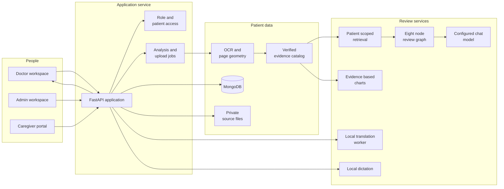

# PrepPulse

## Physician assistance for long patient histories

External text AI requests through the supported adapters pseudonymize registered patient identifiers before transmission. Private local model requests stay local. Read the [privacy controls, verification and limits](documentation/PATIENT_PRIVACY.md), including the separate Azure storage protections and local disk requirements.

Processing progress, provider availability checks, Upcoming appointments and administrator deletion are described in [Processing and maintenance](documentation/PROCESSING_AND_MAINTENANCE.md).

The latest [release verification](documentation/RELEASE_VERIFICATION_2026_11_06.md) records the local regression checks and the deployed PP006 ingestion, chart, translation and cleanup test.

PrepPulse is a physician assistance application that brings a patient’s longitudinal record into one review workspace. Instead of opening documents one by one across a long history, a doctor can see dated measurements, consultations, admissions, medication context and other documented events together, then open the source record behind each item.

The application uses OCR and patient scoped retrieval to organize information from uploaded records. Its review agents prepare a structured consultation brief, highlight changes and possible gaps, and help the doctor ask questions across the patient’s history. Supported measurements can be plotted from dated OCR evidence. Every available citation links back to the original page, where the doctor can inspect the document and the recognized source region.

The source record remains available throughout the workflow. PrepPulse helps reduce the effort of finding and comparing information; it does not replace review of the original records, clinician judgment, or the doctor’s responsibility for decisions.

When structured extraction encounters a combined or nonnumeric lab reading, it retains that source-linked fact for review and continues processing valid findings. It does not turn a combined blood-pressure and pulse reading into a lab number.

## Product workflow

1. An administrator registers or selects a patient, records demographics, assigns a doctor and uploads documents.
2. The service preserves source files, extracts text and page coordinates, and stores the records under the patient’s permanent PrepPulse identity.
3. The doctor opens the patient workspace, runs analysis and reviews an evidence linked brief, the patient timeline, findings, earlier visits and supported charts.
4. The doctor can ask questions about the patient’s records. Responses link to retrieved source evidence, and chart requests use dated measurements rather than values invented by a language model.
5. The doctor reviews and signs a care pathway when appropriate. The signed version remains attached to the patient; caregivers can report checklist completion and share notes through their restricted portal.

Administrators can search the patient directory and find patients by name, permanent ID or folder alias when scheduling appointments. Caregivers can search their assigned care plans by patient name or ID.

## Technology at a glance

1. Browser: React 18, TypeScript, Vite, Recharts and React Markdown.
2. API: Python, FastAPI, Pydantic and authenticated role aware routes.
3. Persistence: MongoDB for patient identity, documents, appointments, visits, analysis jobs, chat sessions, chart artifacts and care pathways. Original files are stored separately in private application storage.
4. Document processing: PyMuPDF for native PDF text, Tesseract for image OCR, and source geometry retained for page level evidence.
5. Retrieval and agents: LangChain components for provenance aware chunks and retrieval, BM25 plus configured embeddings with reciprocal rank fusion, and an eight node LangGraph review workflow.
6. Model options in the local implementation: LM Studio, Ollama, Sarvam API, or a deterministic mock fallback, selected by server configuration.
7. Translation and dictation: local IndicTrans2 through the isolated WSL2 worker, and faster whisper for local speech transcription.

The current local provider boundary and its limitations are explained in [AI and RAG](docs/product/AI_AND_RAG.md). In particular, selecting Sarvam for chat does not currently provide Sarvam embeddings. The configured embedding factory uses deterministic mock embeddings in that mode, while lexical retrieval remains available. Gemini routing, Azure model routing and automatic provider failover are not implemented in the local UI release.

## Architecture overview

The browser uses the API for authentication and patient scoped operations. It does not connect directly to MongoDB or receive unrestricted filesystem access.

For the complete data flow and component boundaries, see [Architecture](docs/product/ARCHITECTURE.md) and [Backend and data](docs/product/BACKEND.md).

## What the AI components do

1. **Classification agent** reviews documented diagnoses, HbA1c and glucose context, treatment history, and relevant type 1 diabetes evidence. Its category helps orient the consultation brief and requires clinician verification.
2. **Trajectory agent** compares dated measurements and summarizes documented change. A trend is a description of available records, not proof of cause or a treatment recommendation.
3. **Care gaps agent** identifies possible missing or overdue items in the supplied record. Missing documentation is not treated as proof that care was not delivered.
4. **Mismatch agent** surfaces conflicting record statements, especially around medicines and doses. The doctor reviews the source records and decides what to do.
5. **Comorbidities and history agent** brings forward relevant earlier conditions, consultations, admissions and procedures with source context. It helps the doctor see history beyond the latest laboratory panel.
6. **Caregiver preparation agent** drafts plain language preparation reminders from documented information. It must not invent symptoms, conditions, thresholds or treatment instructions.
7. **Assistive prompts agent** offers questions that may help the doctor explore the record. A prompt is a navigation aid, not evidence or a finding.
8. **Brief compiler** assembles review stages into the application’s ConsultationBrief contract. The API validates and enriches the result with source catalog information.
9. **RAG and chat** retrieve patient scoped evidence for questions and construct turn specific citations. Replies can include structured prose, actual tables or supported chart artifacts.
10. **Charting** plots supported dated measurements found in OCR evidence. It does not estimate missing values or create a plot from model prose.

The detailed stages, prompts, diabetes evidence inputs, chart scope and known limits are in [AI and RAG](docs/product/AI_AND_RAG.md).

## Diabetes review and chart scope

The classification prompt considers five evidence groups: recorded diagnoses and clinician impressions; HbA1c; glucose context; diabetes medicine history; and documented type 1 or insulin dependence context, including DKA history where present. This is a limited assistive review prompt, not a complete diagnostic algorithm.

Numerical charts support these measurement families: HbA1c, fasting glucose, post meal glucose, eGFR, urine ACR, creatinine, LDL cholesterol and blood pressure. Fasting and post meal glucose remain separate series. Other documented conditions and measurements can be summarized with cited records or occurrence tables, but are outside the numerical chart whitelist.

## Application pages

1. **Doctor workspace:** Today, Patients, Records, Care pathways and Settings. Patients is the main consultation view, with identity, longitudinal history, source linked findings, chat and review controls.
2. **Administrator workspace:** New patient intake, Patient appointments, Patient directory, Accounts, Caregivers and Settings. Administrators manage identity, access, assignments and schedules.
3. **Caregiver portal:** My care plans displays signed plans assigned to that caregiver type, supports the available language rendering and download, and records caregiver reported completion and notes.

The [Frontend guide](docs/product/FRONTEND.md) describes each page and interaction.

## Set up the local implementation

Start with the [Setup and operations guide](docs/product/SETUP.md). It covers prerequisites, MongoDB, administrator creation, API and browser startup, local model configuration, Sarvam API configuration, IndicTrans2 setup, dictation, verification and troubleshooting.

The local browser and API implementation do not require an API key when using an available local model. For Sarvam chat, configure the credential in the API process environment and set the provider to Sarvam. Do not commit credentials. The setup guide explains provider selection and current embedding behavior before you choose a mode.

## Branches and release notes

The UI and main branches contain the local browser implementation. UI is the review branch for browser changes, and main is the reviewed local release. The deployment branch is maintained separately for the hosted Azure product and has its own product documentation and operating guide.

## Documentation map

1. [Product overview](docs/product/PRODUCT_OVERVIEW.md): fuller product rationale and intended workflow.
2. [Architecture](docs/product/ARCHITECTURE.md): system responsibilities, workflows and design principles.
3. [Frontend](docs/product/FRONTEND.md): pages and role specific user flows.
4. [Backend and data](docs/product/BACKEND.md): OCR, source storage, database collections, identity, access and API contracts.
5. [AI and RAG](docs/product/AI_AND_RAG.md): provider behavior, retrieval, agents, charts, translation and limitations.
6. [Setup and operations](docs/product/SETUP.md): installation and local configuration.
7. [Documentation index](docs/README.md): detailed product guides.

## Clinical use boundary

PrepPulse is an assistive physician workflow. AI generated classifications, summaries, translations, chart context and caregiver reminders require clinician review. Source citations help locate the supporting record but do not independently establish that a medical claim is correct.
