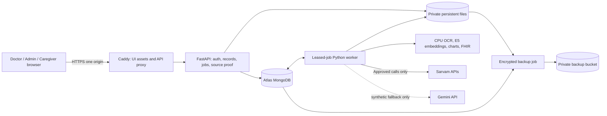

# PrepPulse deployment plan

**Historical proposal (4 November).** The owner subsequently approved implementation and Azure deployment on 5 November 2026. The actual deployed stack, Sarvam-first routing, setup, testing and remaining Azure OpenAI restriction are documented in [README.md](README.md) and [VERIFICATION.md](VERIFICATION.md). Those documents supersede this proposal's unimplemented Oracle/Atlas architecture and zero-spending phase. The remainder is retained as the original planning record.

**Written:** 4 November 2026, Asia/Kolkata.

**Branch:** `deployment`, created from tested `ui_testing` commit `4f280f2bc2b982bb746ba6684356f6c53cebe121`.

**Current spending authority for this phase:** zero provider calls and zero cloud provisioning.

**Release scope proposed:** an authenticated, synthetic-patient demonstration first; a real-patient service requires a separate operational, clinical and data-processing review.

## 1. Proposed stack, at a glance

| Component | Proposed first hosted release | Implementation state |
| --- | --- | --- |
| Frontend | Existing React/TypeScript/Vite build, served as static assets by Caddy on the application VM | Existing UI works locally; production routing/build delivery remains to implement |
| Public entry point | One HTTPS hostname; `/` for the UI and `/api/` for FastAPI | Not configured |
| Application host | Oracle Always Free eligible A1 VM, subject to account approval and actual regional capacity | Not provisioned; Arm compatibility must be tested |
| API | Existing Python 3.11+ FastAPI, initially one API process | Local implementation tested; public-server hardening remains |
| Background work | Separate supervised Python worker with Mongo-backed leased jobs | Proposed; current thread pools and in-memory activity sets are insufficient |
| Database | MongoDB Atlas Free, with restricted network access and application-scoped credentials | Local MongoDB is tested; Atlas is not provisioned/tested |
| Private files | Persistent private VM data volume for working originals/PDFs; encrypted independent backup in a private bucket | Local source paths work; migration/storage boundary remains |
| Backup storage | OCI Object Storage within verified free allowance; optional R2 alternative | Not provisioned; credentials, retention and restore remain to implement |
| Agent/chat/FHIR extraction | Sarvam primary; Gemini only for explicitly enabled synthetic-data fallback | API adapters tested locally |
| Embeddings | Pinned multilingual E5-small, CPU, running on the hosted server | Python implementation tested on Windows; Linux/Arm remains untested |
| OCR / charts / FHIR rendering | Existing local Python processing on the server | Not paid model inference; host dependency/performance checks remain |
| Translation / speech | Sarvam APIs, revision-aware translation cache and opt-in audio | Tested locally; cloud worker/configuration remains |
| PC models | Disabled in the public deployment profile | Existing local behavior retained on `UI`/`ui_testing`; deployment routing needs an explicit policy |
| Delivery | Versioned artifact/image, owner-triggered release and reversible code switch | No CI deployment or public release exists yet |

This is a proposed consolidation of the tested system, not a new UI redesign. Doctor, admin and caregiver pages, source proof, chart artifacts, multilingual checklists and visit history must retain their present behavior.

## 2. Recommendation and what “free” can mean here

Use **one eligible Oracle VM for the frontend, API, worker and CPU embeddings**, **Atlas Free for MongoDB**, and **private persistent storage with an independent backup**. Serving UI and API from the same HTTPS origin avoids introducing cross-site login/cookie complexity into the current relative `/api` frontend.

Infrastructure may remain within free allowances if accounts, capacity, usage and billing settings permit. Sarvam inference still requires credits. With no credits, we can host existing records and cached outputs, but cannot promise new AI answers, translations, speech or fresh agent analyses. Gemini is not an unlimited replacement or a route around provider restrictions.

Do not provision services based on temporary trial credits, turn on paid upgrades silently, or advertise the complete system as permanently free. Budget alerts are notifications, not guaranteed spending stops. Our application limits also cannot prevent unrelated account usage or infrastructure charges.

**Proposed decision:** approve the architecture first; later approve the exact resource list and provider-test budget before creation or live calls. Until then, this branch contains documentation only.

## 3. Current evidence and gaps

The detailed local evidence is in [UI_TESTING_REPORT.md](../UI_TESTING_REPORT.md). It includes 107 selected passing Python tests, three passing fixture browser workflows, a successful frontend/package build, two independent provider workflows over the same 15-source synthetic patient, protected FHIR export, source-file restore verification and five-language PDF tests.

The local 100-user rehearsal used ten concurrent flows and 1,500 replicated processed documents. It passed 100/100 flows, with p95 0.906 seconds, and occupied about 56.70 MiB of MongoDB data plus 0.64 MiB of indexes. It did not run 100 simultaneous AI jobs, use 100 independently reviewed clinical histories, or establish five-day availability.

The final cached-structured analysis ran for approximately 400 seconds on Sarvam and 202 seconds on Gemini; cold extraction took longer. These measurements rule out treating the entire analysis as an ordinary short serverless request. Translation can also take significantly longer when a repair or provider timeout occurs.

Already known gaps must remain visible: four excluded legacy test cases, no actual-host benchmark, no cloud restore exercise, no complete terminology/profile interoperability certification, no fluent clinical certification of translations, and no five-day soak.

## 4. Hosting options and current service constraints

Public documentation was checked on 4 November 2026. Recheck the actual account console before selecting resources; eligibility and limits can change.

### 4.1 Recommended host: Oracle Always Free eligible compute

The current official allowance for an Always Free A1 tenancy is **1,500 OCPU-hours and 9,000 GB-hours monthly**, described as **2 OCPUs / 12 GB RAM**, rather than the older 4/24 figures. Oracle also lists 200 GB combined boot/block storage, account-dependent object-storage allowances, and idle-instance reclamation. Capacity is not guaranteed. Use only eligible resources in the tenancy's home region. [Oracle Always Free resources](https://docs.oracle.com/en-us/iaas/Content/FreeTier/freetier_topic-Always_Free_Resources.htm).

Proposed starting allocation, conditional on console eligibility: one Ubuntu A1 VM with 2 OCPUs and 12 GB RAM; approximately 50 GB boot plus a 50 GB private data volume. This allocation is a plan, not a reservation or measured memory requirement. Leave allowance for retained volumes/backups and inspect the entire tenancy, not just this VM. Avoid paid load balancers, NAT gateways or additional disks by default.

Do not fall back automatically to a 1 GB micro VM: this application includes PyTorch embeddings, OCR and concurrent HTTP work. Treat a smaller machine as a new benchmark decision. Do not generate artificial traffic or load to avoid idle-reclamation rules. Keep recovery artifacts and backups outside the VM.

### 4.2 Vercel and Cloudflare Pages

Both are plausible **frontend** hosts. Cloudflare Pages lists a free allowance of 500 builds/month, 20,000 files and a 25 MiB per-static-asset limit. These assets must contain only frontend code/assets, never patient records or model caches. Pages Functions have separate Workers limits. [Pages limits](https://developers.cloudflare.com/pages/platform/limits/).

Vercel's current Functions limits list up to 300 seconds for Hobby Node/Python with Fluid Compute, while other configurations differ. Our observed analysis can exceed that, and model packages/private files/durable background execution require additional design. Vercel Hobby also has personal/non-commercial restrictions. It is not the recommended all-in-one backend. [Function limits](https://vercel.com/docs/functions/limitations), [Hobby plan](https://vercel.com/docs/plans/hobby).

If a Pages/Vercel frontend is selected later, retain the VM API/worker. Either provide a carefully tested same-origin API proxy or deliberately implement cross-origin credentials, exact-origin CORS and CSRF controls. A Vite development proxy is not production routing. Unrelated provider subdomains can encounter third-party-cookie restrictions; changing `SameSite` alone is not a reliable fix. A custom domain can simplify this but is not inherently free.

The recommended VM-served UI avoids those extra moving parts for the first demonstration. Static CDN hosting can follow after the working release if beneficial.

### 4.3 GitHub Pages

GitHub Pages serves static HTML/CSS/JavaScript; it cannot run this FastAPI/worker/MongoDB workload. Use it for a public project page or static frontend prototype, subject to service terms and deliberate API integration. A public repository is never a private patient-file store. [GitHub Pages overview](https://docs.github.com/en/pages/getting-started-with-github-pages/what-is-github-pages).

### 4.4 Render Free

Render Free web services spin down after inactivity, do not offer persistent disks, and lose filesystem changes across restarts/redeploys/spin-down. These properties conflict with the current private originals and SQLite caches; a sleeping process cannot be our durable worker. It remains a limited stateless-preview alternative after storage and job changes, not a direct production move. [Render Free documentation](https://render.com/docs/free).

### 4.5 Hugging Face

Uploading weights to the Hub does not create an always-on free inference API. Current Spaces documentation says creating compute-backed Docker/Gradio Spaces requires a paid plan, with specific exceptions; CPU Basic having no hourly charge is not the same as free account eligibility. It also documents sleep, nonpersistent default disk and outbound port restrictions that prevent an ordinary Atlas MongoDB connection. Do not rely on historical “free Docker Space + Atlas” recipes. [Spaces overview](https://huggingface.co/docs/hub/spaces-overview).

### 4.6 If Oracle capacity or signup fails

Stop at the account/capacity gate. Options for owner selection are an explicitly priced VM, an eligible sponsored compute account, or a more limited stateless synthetic preview with separately solved persistence/worker constraints. Do not silently replace the architecture with a sleeping host, expose the developer laptop through a permanent tunnel, or provision a paid resource. A five-day external pilot needs a host that actually stays available.

## 5. Database choice and storage alternatives

### 5.1 Atlas Free: preferred initial database

Atlas fits the existing PyMongo collections and query semantics. Current free-cluster documentation limits uncompressed BSON plus indexes to 0.5 GB, connections to 500, throughput to 100 operations/second and transfer to 10 GB in / 10 GB out per rolling seven days. Free-cluster backup options are currently documented, but their account eligibility/cost must be checked; independent exports remain required. Private endpoints and dedicated resources are not included. [Atlas free limits](https://www.mongodb.com/docs/atlas/reference/free-shared-limitations/), [cluster comparison](https://www.mongodb.com/docs/atlas/manage-clusters/).

Keep one environment database for the hosted demo. Do not migrate the load-test, restore-test and duplicate provider databases into the free cluster. Share bounded connection pools, add pagination, inspect real query plans and avoid downloading the entire chart repeatedly. Allowlist only the selected backend egress address; require TLS and application-scoped database credentials. Keep database administration separate from the app login roles.

### 5.2 Alternatives

| Database | Suitability | Decision |
| --- | --- | --- |
| MongoDB Atlas Free | Existing data model; managed service; strict resource limits | Preferred while measured workload fits |
| Self-hosted MongoDB on the same VM | Retains current query model and avoids a second database bill | Fallback only with extra memory/patching/backup work; a single VM would hold API and database failure domains together |
| Supabase Free | Useful hosted PostgreSQL/storage, but not a drop-in replacement for PyMongo | Defer: requires deliberate data/query/auth migration and regression work |
| Oracle relational/NoSQL services | Their free offerings do not imply compatibility with our MongoDB collections | Defer unless a separately approved migration demonstrates compatibility |

Supabase currently lists 500 MB database and 1 GB file storage on its Free plan, with inactivity pause. Those allowances do not justify rewriting this already working MongoDB system for this release. [Supabase pricing](https://supabase.com/pricing).

## 6. Proposed runtime architecture

Initially the VM runs a reverse proxy, one API process and one supervised worker process. The worker may execute two bounded work slots after benchmarking; do not launch multiple uncoordinated application workers first. The HTTP request creates/reads a job and returns promptly; generation continues under the worker. Existing polling and animated process names remain, with adaptive request rates.

No database, model server, worker control port or private directory is exposed directly. API traffic reaches FastAPI through the proxy; MongoDB accepts only the backend. Only the reverse proxy handles public application traffic. SSH is key-based and source-restricted.

## 7. Public URL, HTTPS and request behavior

1. Choose an owner-controlled hostname. An existing domain works; a free DNS subdomain may avoid a domain purchase but its terms, ownership and certificate validation must be checked. No hostname is created in this phase.
2. Point DNS at the approved VM address, then configure Caddy certificate issuance/renewal. Public TLS success is a launch gate, not an assumed configuration.
3. Serve hashed `web/dist` assets with long cache lifetimes. Serve the HTML entry point with revalidation. Preserve navigation/deep-link behavior; nonexistent `/api` routes must not return the SPA HTML.
4. Proxy `/api/` to a loopback-bound API port. Forward original scheme/address only from the trusted proxy. Microphone capture must work under HTTPS.
5. Apply `Cache-Control: no-store` to authenticated clinical responses, previews and generated PDFs. Do not put patient content into CDN caches, public buckets or static build output.
6. Configure upload limits to accommodate the existing 30 MiB/file and 250 MiB/folder limits, or explicitly lower and document both UI and API limits together. Include multipart overhead. Never discover a smaller proxy limit during a live demonstration.
7. Keep ordinary endpoints short. Analysis uses jobs; chat generation uses turns/jobs. Read-aloud, transcription, translation and PDF rendering must be reviewed for bounded deadlines so a reverse-proxy timeout does not duplicate a paid operation.

## 8. Identity, sessions and role isolation

Existing public/internal identifiers and assignments remain stable: permanent patient IDs, external folder aliases, staff account IDs, doctor assignments, caregiver type and per-patient caregiver access. Do not reseed accounts or renumber patients during migration.

Public deployment changes to implement after approval:

- Set secure, HttpOnly, host-only session cookies with an explicit production name and stable high-entropy secret. The current `https_only=False` is a local setting and must become environment-controlled with a secure production default.
- Retain CSRF verification and add an exact-origin/host policy for browser mutations, including login protection. Signed-cookie sessions currently have no central per-session revocation record; implement server-side session version/revocation semantics for logout, disable, reset and compromise response. Never store clinical content in the cookie.
- Add login throttling and bounded request/body limits. Test account disablement, password changes, session expiration and old-session rejection. Rotate weak or previously shared credentials before public access; no passwords appear in this plan or Git.
- Preserve the existing rule that administrators manage registration/appointments/metadata but do not obtain clinical brief/chat access by default. Preserve doctor assignment checks on every patient/visit/document/chat/FHIR route.
- Preserve family versus professional caregiver checks on signed plan listing, translation, PDF download, completion reports and notes. A valid caregiver login must not expose the other caregiver type's pathways.
- Use restrictive trusted-host handling, safe error responses, suitable content/security headers and request correlation IDs. Avoid logging prompts, transcripts, source text, tokens or signed links.

Use Asia/Kolkata clinical dates consistently with the current care workflow. Store timestamps in UTC, display the intended local timezone, and test midnight boundaries, appointment filters and daily task reset. Do not use the server's default timezone to infer a patient's clinical day.

## 9. Durable jobs and AI admission control

### 9.1 Why this must change

The current app uses `ThreadPoolExecutor(max_workers=2)` and process-local `active_chat_turns`/`active_brief_jobs` sets. They work for the local rehearsal but are not reliable leases across restarts or multiple processes. Existing checkpoints preserve some completed work; they do not schedule it durably.

### 9.2 Proposed Mongo-backed worker

Avoid adding Redis for the first small deployment. Extend the existing job collections with a reviewed schema covering job type, patient/visit/session, source/revision fingerprint, priority, attempt, timestamps, lease owner, lease expiry, retry-after, progress and safe error code.

- Atomically claim eligible work with `find_one_and_update`; refresh a lease while executing. Only the current owner may finalize that attempt.
- Use unique operation fingerprints and optimistic revision checks. Reject stale translations/briefs and duplicate active analyses for the same inputs.
- On worker restart, recover expired leases. Resume validated document/node checkpoints when identities match. Bound retries with exponential backoff and jitter; honor provider cooldowns.
- Treat execution as at-least-once. A timed-out paid call may have succeeded remotely; local idempotency cannot guarantee exactly-once provider billing. Do not blindly replay ambiguous paid calls without bounds.
- Enforce global and per-user limits for analysis, chat, translation and voice. Start with one analysis slot and one interactive slot, with fairness so an import cannot monopolize all service capacity. Confirm final concurrency against provider quotas and VM memory.
- Prevent queue flooding; proposed starting maximum 50 pending heavy jobs, with an explicit busy state and resumable upload metadata. This is an initial policy to test, not measured capacity.
- Expose queued/running/completed/failed/retryable states and the actual process name. Never show completed output when the job failed or render a saved old brief as a freshly generated result.

### 9.3 Polling and database pressure

The current UI has 1.5-second multilingual polling and several 3/5/10/15-second intervals. At 100 active clients, one 1.5-second poll alone creates about 67 requests/second; multiple database reads per request can exceed Atlas Free throughput before AI work starts. The local benchmark does not resolve this limit.

Plan targeted polling behavior changes, not visual redesign: poll only visible/current jobs, stop on completion, deduplicate shared card/checklist reads, slow stable data to 15-30 seconds, add jitter/backoff and suspend hidden tabs. Consider one authenticated progress stream later if it materially reduces reads. Benchmark measured database operations as well as HTTP requests.

## 10. Model/provider plan and zero-credit behavior

| Capability | Hosted behavior proposed | If unavailable or unfunded |
| --- | --- | --- |
| Agents, summaries, text answers, Stage 2 extraction | Sarvam primary with persistent budget reservations | Preserve prior outputs; show unavailable/queued-by-policy, not fabricated findings |
| Gemini fallback | Explicit synthetic-only enablement after project quota/model access verification | Disabled for real-patient operation and by default when no funded/approved provider is available |
| Python embeddings | Pinned E5-small on server CPU | Known lexical fallback can remain explicit; show degraded retrieval rather than claiming hybrid completeness |
| Translation | Sarvam, protected values, revision cache, validated complete snapshot | Keep last valid selected-language version for the same revision; show unavailable for new text instead of mixing partial English/native output |
| STT / TTS | Sarvam, transient dictation audio, reviewed transcript, opt-in playback | Typing and text remain available; no attempt to reach the developer PC |
| OCR / charts / FHIR rendering | CPU deterministic tools; charts from owned, verified values | Continue where inputs already exist; do not claim unprocessed files have structured facts |

The currently tested `auto` router always appends a local provider. Deployment needs an explicit configured provider list/allowlist so cloud fallback stops after eligible cloud services instead of attempting `127.0.0.1:1234` or a home LAN address. WSL2 IndicTrans2 is not a cloud dependency; disable that fallback unless a separate reviewed hosted runtime is deliberately added.

Do not upload Sarvam-sized chat models, the local TTS GGUF or IndicTrans2 to a free VM. The one deliberate server-side model is the smaller pinned CPU embedding model. Validate its Linux Arm wheel/runtime compatibility, cold-start memory and speed before committing to A1; ONNX or a different embedding model would require separate measurement/reindexing approval.

Credit control must preserve the rehearsal's private usage ledger, key deduplication, organisation pool mapping and no rate-limit evasion. The ten-credit threshold is only an estimate from optional dashboard starting balances; no live-balance API was confirmed. A public deployment needs an operator procedure to replenish/check balances and stop work before known budgets are exhausted.

For the **current no-credit phase**, do not run providers, probe billable endpoints, queue new generation or automatically prewarm five languages. The later hosted profile should support an explicit AI-disabled state; cached briefs, records, previously generated charts, signed plans, checkboxes and stored translations remain useful. New uploads may be stored with a truthful pending-analysis state. A deterministic chart from existing verified data does not require model credits.

For an eventual funded pilot, estimate cost from workload rather than multiplying the rehearsal's INR 36.73 by patients: that test included failures, fixes, repetitions and conservative speech reservations. Record current provider pricing at funding approval, measure one cold patient/one warm patient and enforce daily plus total caps. Translating only the selected language and reusing unchanged segments substantially reduces duplicate calls without changing clinical content.

## 11. Data preservation: what must survive the move

Git branches do not contain the database or private files. Deploying the branch alone cannot migrate patient records. Prepare an explicit, encrypted migration package and verify both metadata and file bytes.

| Data group | Existing examples | Preservation requirement |
| --- | --- | --- |
| Accounts and access | `users`, `staff_directory`, `patient_access`, `caregiver_access` | Internal/public IDs, aliases, roles, caregiver types and assignments retained; credential reset policy separate |
| Registry | `patients`, `patient_aliases` | Immutable PrepPulse IDs and searchable external folder IDs retained |
| Originals and index | `workspace_documents`, `workspace_files`, private source tree | Every selected file, filename, relative path, SHA-256, patient/document mapping preserved |
| OCR / facts / retrieval | `patient_documents`, `document_chunks` | OCR text/tokens/tables/page geometry; grounded entities/review queues; chunk provenance retained |
| FHIR | `stage_3_fhir_output`, `fhir_versions` | Resource identities, source extensions and prior immutable versions retained |
| Consultation | `appointments`, `visits`, `review_decisions`, `briefs` | Dates, snapshots, clinician decisions and previous-visit links retained |
| Care plans | `pathways`, `pathway_items`, `care_drafts`, `care_visit_checks` | Signed English plan unchanged; draft revisions and clinician preparation ticks retained |
| Caregiver follow-up | `care_reports`, `care_notes` | Dated daily completion reports, missed-task history and caregiver notes retained independently |
| Translation | `care_translations`, `care_segment_cache`, `care_language_cache` | Revision/source/provider identity preserved; stale model caches not relabelled as new translations |
| Chat | `chat_sessions`, `chat_messages`, `chat_artifacts`, `chat_turns` | Ownership, message/citation links, saved chart data and active/interrupted turn state retained |
| Operations | `jobs`, `analysis_checkpoints`, actual audit collections | Retain useful history; migrate active work into explicit paused/recoverable states |
| Local private state | API usage SQLite, embedding SQLite, model pin/download cache | Preserve usage/cost history; embedding cache can be rebuilt; never place private databases in Git/images |

This is a starting inventory from the repository, not permission to drop unlisted collections. The future migration script must enumerate the actual selected database, account for every collection, and produce a count/hash manifest.

The local `preppulse` workspace and `ui_testing` copies may have diverged. Owner selection of the authoritative source is required before migration. Prefer current authoritative patient/clinician records; optionally import reviewed FHIR/derived outputs from a test copy only after matching permanent IDs and exact source hashes. Never overwrite newer signed plans or caregiver reports with an older cloned copy. Exclude the 100-user load database, restore databases, synthetic load credentials, test profiles and redundant provider copies.

## 12. Private file design and migration mechanics

### 12.1 First release: persistent disk plus independent backup

Keep the initial working-file implementation simple on the VM: originals and generated English archives live under a dedicated persistent data root, outside both the web root and release directory. SQLite files share that persistent root. Temporary renders use a bounded temporary directory and are deleted. The application user has only necessary permissions.

Windows absolute `source_path` values will not work on Linux. A migration must map each record to its verified copied file under the new private root; path separators, Unicode filenames and case collisions need explicit checks. Preserve original path metadata privately if useful, but never trust it for serving or expose it to browsers. No source-proof coordinate conversion is required: normalized boxes remain bound to the original page/content.

The previous rehearsal does not require an object-storage adapter for this single-VM layout. A persistent mounted volume plus verified off-machine backup is an acceptable first proposal; it is not high availability. A second VM or ephemeral host would require shared storage changes before scale-out.

### 12.2 Optional next step: primary object storage

If selected before implementation, add a storage interface for immutable source objects, signed archives, private reads, local bounded staging and checksums. OCR/rendering resolves an authorised object to a temporary file; patient-scoped routes continue authorizing every preview/download. Do not make a bucket public to get source proof working.

Use opaque object keys with patient/document IDs and content hashes, not guessable public patient names. Verify object completion before committing a usable record; retain pending metadata on failure and allow idempotent retry. Garbage collection must distinguish abandoned uploads from referenced clinical originals and immutable signed records.

OCI currently lists a 20 GB combined allowance for an Always Free-only account and 50,000 object requests/month, with different trial/paid-account conditions; verify the applicable console state. [OCI storage allowances](https://docs.oracle.com/en-us/iaas/Content/FreeTier/freetier_topic-Always_Free_Resources.htm).

R2 is an alternative: current Standard storage includes 10 GB-month, one million Class A and ten million Class B operations, with no internet egress charge. It is a metered service above allowances; enrollment/billing requirements must be checked before use. A private bucket and scoped credentials are mandatory. [R2 pricing](https://developers.cloudflare.com/r2/pricing/), [R2 setup](https://developers.cloudflare.com/r2/get-started/).

### 12.3 Staged migration sequence

1. Choose source database/data boundary and freeze a migration snapshot. Create a manifest of IDs, collection counts, file hashes, sizes and source relationships.
2. Export the source without modifying it. Use a brief write pause or another reviewed consistency method; independently dumping changing collections is not a coherent clinical snapshot. Free-tier export options must match Atlas restrictions.
3. Restore into a new empty target database using explicit namespace mapping and a restricted migration identity. Do not restore over an existing database silently.
4. Copy private files; verify every SHA-256 against the manifest. Rewrite only approved storage references, with a mapping report and reversible original values.
5. Verify indexes, unique IDs, account types, patient relationships, all pages/boxes, previous visit snapshots, English archives, selected-language downloads, chat links and FHIR references.
6. Mark imported in-flight jobs paused/interrupted, then recover only after the worker starts and its fingerprint/lease checks pass. Never dispatch them automatically during restore.
7. Take a target backup and restore that backup into a disposable verification target. Compare document/file hashes and relationship checks.
8. Open a private staging preview; only after owner review switch the public entry point to the target. Keep the original workspace intact until a separate retention/deletion decision.

## 13. Backups, rollback and retention

Proposed demo recovery objectives: **RPO up to 24 hours** for routine backups, **RTO target four hours** after account/compute access is available. These are objectives requiring a timed restore, not present guarantees. A pre-release backup is additionally required before schema/data migrations.

Back up MongoDB records, source files, signed English documents, private usage ledgers and the release/configuration version together with a manifest. Use SQLite's consistent backup mechanism or a reviewed application pause, not a casual copy of an active WAL database. Preserve application audit history without exposing it in public logs. Keep encryption keys outside the bucket/backup package and document owner recovery access.

Keep an additional encrypted, verified owner-held offline copy when practical: a bucket in the same cloud account does not protect against account-access loss. Bound document sizes before persistence, including MongoDB's individual-document limit; very large OCR payloads need an explicitly tested split/storage strategy rather than a failed upload after files have been accepted.

Initial retention proposal: seven daily encrypted backups and two release checkpoints, bounded by actual free storage allowance. Deduplicate immutable originals where appropriate; monitor total retained bytes. Do not silently delete clinical versions to satisfy a quota. Restore testing must include an original PDF highlight, a signed care plan and dated caregiver reports, not just database ping.

Code rollback switches to the previous immutable release/image and compatible config. It must not discard patient writes made after deployment. Schema changes need an expand/contract or explicitly tested backward-compatible strategy. A destructive database restore is a separate incident decision with recorded data-loss implications; `git reset` is not a data rollback.

## 14. Capacity model for another 100 patients and five days

### 14.1 Storage planning

The measured replicated test is about 57 MiB including indexes for 100 patients/1,500 processed documents. Doubling for an additional similar-sized cohort suggests roughly 115 MiB before new histories, caches and version growth. That is arithmetic from synthetic data, not a capacity guarantee. Scanned originals and larger OCR payloads may be substantially bigger. Measure uncompressed BSON and indexes, not compressed backup size, against the database allowance.

The supplied original folders averaged about 0.27 MiB, giving roughly 27.5 MiB for 100 similarly small folders. Use an adverse-case scenario too: 100 patients x 15 files x 5 MiB is about 7.3 GiB of originals before backups. Storage quota is therefore not equivalent to a fixed number of patients.

Proposed warnings at 60% database/disk quota, action required at 75%, and a controlled intake pause before 85%. Keep reading existing records and accepting safe small follow-up updates where possible. Do not rely on an automatic paid database upgrade.

### 14.2 People, concurrency and AI calls

One hundred distinct people over five days is very different from 100 active browsers or 100 parallel analyses. Plan three separate workloads: active web sessions, document processing, and inference/translation/audio. Measure each on the actual host and provider project.

For illustration, 100 users x five days x four new conversational questions equals 2,000 generation requests, before intake/agent/translation calls. A 15-record cold intake can require roughly 20-30 generation requests depending on workflow/repair/retry behavior; measure the actual coefficient before funding 100 imports. A six-to-seven-minute serial analysis would take roughly eleven hours for 100 patients even before cold extraction. Queueing and scheduled imports are required; do not promise instant bulk intake.

Avoid eager re-analysis on every page open or appointment. Reuse source/model/prompt fingerprints, render cached facts without paid extraction, and generate only the selected language/revision. Existing chart artifacts and supported deterministic chart requests should not incur unrelated LLM calls.

### 14.3 Host resource envelope

Benchmark E5, Tesseract/PyMuPDF, API/worker and OS memory together. Cache one embedding model per worker, constrain numeric library thread counts, bound PDF render dimensions and isolate OCR from interactive requests. Measure cold and warm retrieval, long document handling and startup after reboot. Persist model cache so every release does not redownload it.

Proposed launch thresholds: ordinary warmed non-AI API p95 under two seconds at ten active flows; no unexpected cross-patient responses; no out-of-memory events; average DB operation rate with substantial headroom below the free limit; and understandable queue/progress state under burst load. These are acceptance targets to evaluate, not achieved cloud results.

## 15. Configuration and packaging work to implement later

### 15.1 Already implemented configuration to carry forward

| Setting | Hosted intent |
| --- | --- |
| `PREPPULSE_MONGO_URI`, `PREPPULSE_MONGO_DB` | Restricted Atlas connection and selected deployment database |
| `PREPPULSE_PRIVATE_ROOT` | Persistent private mounted directory |
| `PREPPULSE_SESSION_SECRET`, `PREPPULSE_SESSION_COOKIE` | Stable deployment-only secret and cookie name; separate from local testing |
| `PREPPULSE_AI_PROVIDER`, `PREPPULSE_STRICT_AI` | Explicit approved provider; strict failures visible |
| `PREPPULSE_FHIR_ENABLED`, `PREPPULSE_RESUME_ANALYSIS` | Preserve tested structured processing and compatible checkpoint recovery |
| `PREPPULSE_EMBED_PROVIDER`, `PREPPULSE_EMBED_REVISION` | Python CPU and tested immutable model revision |
| `SARVAM_AI_CREDITS_ACC_1/2/3`, pool/start-credit settings | Server-only keys; actual organisation mappings and optional estimate seeds |
| `Gemini_free_api_keys`, `PREPPULSE_GEMINI_ENABLED`, `PREPPULSE_SYNTHETIC_ONLY` | Optional synthetic fallback only, subject to actual project access |
| Sarvam budget / Gemini counter settings | Set zero/disabled for unfunded work; do not reset usage history to replenish limits |
| `PREPPULSE_TRANSLATION_PROVIDER`, `PREPPULSE_TRANSLATION_FALLBACK` | Sarvam and no PC-only translation fallback in cloud |
| `PREPPULSE_VOICE_PROVIDER`, `PREPPULSE_VOICE_FALLBACK` | Sarvam and no unreachable PC audio fallback |

### 15.2 Proposed additions, not current contracts

Plan configuration for deployment mode, trusted origin/host, secure cookies, cloud provider allowlist, explicit AI-disabled mode, job leases/concurrency, Mongo pool bounds, storage backend/root, retention/backup policy and service health. These names/behaviors are not implemented merely by writing this plan; settle a validated configuration schema and documentation before introducing them.

Package with pinned, compatible Python dependencies and the current lockfile approach selected for Linux/Arm. The base system needs Tesseract language assets appropriate to supported OCR, PyMuPDF runtime requirements, Unicode/Indic fonts for PDFs, certificates and timezone data. Browser checklist languages do not imply all corresponding OCR models are already installed or verified. Include prompts and the official FHIR schema in release artifacts; model weights and patient records stay out of Git and public images.

Use a CPU-only embedding environment. Do not include WSL2, LM Studio, desktop paths or full local translation weights in the cloud release. Build the frontend with `npm ci` and the existing TypeScript/Vite check. Release assets must be identified by commit and dependency manifest.

## 16. Implementation work packages and affected areas

All application/configuration code below is **future work requiring owner approval**. Do not execute this table as a task list during the current documentation phase.

| Package | Proposed changes | Main repository areas | Completion evidence |
| --- | --- | --- | --- |
| A: configuration/security | Production config validation, secure session/origin policy, revocation, throttling, readiness | `preppulse_api/config.py`, `app.py`, auth/store logic | Role/session/CSRF/origin tests; no private content in errors |
| B: worker | Leased durable jobs, bounded retries, fair admission, restart recovery | `app.py`, care translation dispatch, new worker module, job indexes | Kill/restart/duplicate submission tests with paid calls mocked |
| C: storage/migration | Persistent roots, path manifest, restore tooling; adapter only if object-primary selected | `clinical.py`, `folder_import.py`, `care.py`, administration preview/download paths, new migration tools | Every selected byte/hash and relationship restored; source proof intact |
| D: provider policy | Deployment allowlist, AI-disabled state, caps and no PC fallback | `cloud_provider.py`, `runtime.py`, `cloud_services.py`, `voice.py`, translation adapter | No-network/zero-budget tests and controlled funded smoke tests later |
| E: workload control | Adaptive polling, bounded Mongo pools, efficient status queries/indexes | `store.py`, API status routes, affected React polling hooks only | No visual regressions; measured Atlas operations under load |
| F: runtime/delivery | Container or pinned system service artifacts, Caddy, worker supervision, private mounts | New files under this deployment folder / reviewed infrastructure path | Linux/Arm build, reboot recovery, HTTPS and retained files |
| G: verification/docs | Fixtures, migration and health checks, full release/runbook updates | Tests, README, TO_DO, deployment documentation | Named pass/fail report and owner manual review |

The clinical prompts, chart measurement selection, OCR coordinate math and existing page layout are protected from unrelated refactoring. Any necessary change there needs a specific reason and focused regression evidence.

## 17. Execution phases and approval gates

| Phase | Work | Spending / permission gate | Exit requirement |
| --- | --- | --- | --- |
| 0: current | Branch and documentation, source review and public service research | Approved now; no API/cloud actions | This plan saved; application unchanged |
| 1: scope approval | Select architecture, data source, synthetic-only audience, AI budget and hostname strategy | Owner approves scoped implementation | Written decisions and bounded work scope |
| 2: local preparation | Implement packages A-E and release artifacts; offline/mocked regressions | Code approval; no provider calls needed | Passing regression and migration rehearsal; zero-credit mode verified |
| 3: account eligibility | Inspect proposed account consoles, actual quotas, free labels, billing/payment requirements and regional capacity | Explicit access/provisioning approval; no silent paid fallback | Resource cost/eligibility checklist passes |
| 4: private staging | Provision approved resources; deploy to non-public/restricted staging; migrate selected synthetic snapshot | Resource creation and deployment approval | Linux/Arm runtime, HTTPS, storage and backup/restore pass |
| 5: funded AI smoke | Minimal capped Sarvam tests; optional synthetic Google comparison; languages/audio | Separate available credits and bounded live-call authority | Every model capability tested once with recorded usage/latency |
| 6: owner review | Manual doctor/admin/caregiver journeys and measured load | Owner accepts preview behavior | Feature, privacy and data-preservation checks signed off |
| 7: pilot | Controlled 100-user/five-day workload and daily monitoring | Public pilot authorization; funded budgets/quota confirmed | End-of-pilot results and incident/usage report |
| 8: release | Tag approved deployment commit and publish operational runbook | Final release approval | Known-good rollback and verified backup; branch merge remains separate |

No dates are promised before capacity, credit and implementation gates pass. A short submission demo can use an explicitly AI-disabled/cached-data profile if no credits become available, but must disclose unavailable fresh generation. Do not describe that profile as live AI processing.

## 18. Verification matrix before opening the site

| Area | Required tests |
| --- | --- |
| Startup | Reproducible Linux/Arm install, prompt/schema assets, fonts, embedding cold/warm start, no home-LAN connections |
| HTTPS/security | Valid renewal-capable TLS, secure cookies, trusted proxy, login throttle, CSRF/origin rejection, session revocation, host checks |
| Admin | Unified intake, folder/file retry, repeat patient aliases, account search/IDs, doctor assignment, caregiver type/assignment, past appointments, directory edits |
| Doctor | Today date boundaries, selected-patient brief, source citations/highlights, analysis progress/retry, visit snapshots, records filters, saved charts and scope warnings |
| Caregiver | Only assigned signed plan/type visible; once/daily tasks, late/missed reporting, notes, doctor follow-up and account revocation |
| Translation | Five languages, rapid toggle/edit races, source hashes, complete publication, changed dose/number rejection, native-script fonts, English archive retained, selected-language PDF pagination |
| Chat/chart | Patient/session ownership, persisted messages/artifacts, all supported point series, 1-10-year windows, no ungrounded cardiac plot, unavailable-source state |
| FHIR | Every selected document retained, official schema/references/provenance checks, immutable versions, quarantine retention, assigned-doctor export |
| Files | Unauthorized preview/download rejected, no traversal, interrupted multipart/folder upload, byte/hash verification, deleted-temp cleanup, retained originals after reboot/release |
| Worker | Restart at each stage, expired lease recovery, duplicate submission, stale revision suppression, fairness and provider-error backoff |
| Credits | Zero-budget causes zero outbound inference; 402/429/timeouts/unknown balances simulated; real capped tests only after funding approval |
| Load | 10 active mixed flows, then planned burst profiles; 100 distinct accounts, bounded imports, real Atlas ops/egress, memory/CPU/disk metrics |
| Recovery | Restore Mongo + files + ledgers to a clean target; check original highlight, previous visit, signed English plan and caregiver completion history |

The four existing legacy failures/exclusions must be resolved or explicitly accepted with reproducible evidence before any claim that the full suite passes. New deployment tests cannot hide them. Provider results and medical language still require human review beyond structural checks.

## 19. Monitoring and five-day pilot protocol

Health endpoints should separate process liveness from DB/storage readiness and worker heartbeat. Readiness must not make billable model requests. Provider status distinguishes configured credentials, last successful call, cooldown, exhausted test budget and unknown balance.

Record request/job IDs, durations, safe error codes, queue age, retries, provider usage, cache hits and restore timestamps. Do not record patient names, clinical text, microphone audio, credentials or generated replies in general logs. Access/audit events remain restricted application records.

Five-day protocol after approval:

1. Day 0: migrate verified synthetic data, restore-test, baseline load and capped live AI smoke; verify owner access from another network/device.
2. Day 1: small invite-only group with all roles; observe real request/database rates and adjust admission limits without changing clinical behavior.
3. Day 2: expand distinct users, exercise repeated visits and caregiver daily completion, inspect previous-day records and translations.
4. Day 3: controlled larger imports and queue restart drill; confirm no double billing loop or lost source document.
5. Day 4: higher active-browser burst, backup restore rehearsal, schema/version/record consistency audit.
6. Day 5: final owner demo, storage/credit reconciliation, latency/error summary and a recorded go/no-go decision.

Stop generation on a configured budget boundary, provider policy issue, unexplained cross-patient result or repeated malformed clinical output. Stop new intake before storage exhaustion; keep existing records accessible when safe. A worker/VM failure should present recoverable status, not erase a clinician's signed plan. The initial pilot is not a production SLA.

## 20. Cost and account checklist

| Item | Zero-infrastructure-cost route | Remaining uncertainty / action |
| --- | --- | --- |
| Compute | Eligible Oracle A1 allowance | Account verification, payment-card requirements, region capacity, eligibility, reclamation and all billed resources need confirmation |
| Frontend | Served on that VM; optional static free host later | DNS/TLS ownership; no paid domain assumed |
| Database | Atlas Free while workload fits | Actual data/index/ops/transfer usage and backup feature billing |
| Files | VM persistent volume within allowance | Total tenancy storage, durability and independent backup |
| Backup | Eligible private object allowance; R2 alternative | Enrollment, request/retention volume, encryption/key recovery and overage controls |
| Embeddings/OCR/charts/FHIR | CPU tools on the approved VM | Arm compatibility and measured host resources |
| Sarvam | Existing/replenished credits | Finite credits are required; currently no live calls authorized |
| Gemini | Eligible synthetic quota only | Model/project quota, terms and billing status; no blanket free-call assumption |
| Operations | Local/free toolchain and owner monitoring | Human response, patching and recovery time are still required |

Do not put accounts on auto-upgrade merely to bypass unavailable free capacity. Do not rotate keys to evade organisation rate limits. Do not reset spending ledgers to manufacture more budget. Changing an API key does not replenish a shared organisation wallet.

## 21. Decisions needed before implementation

The owner can review these together later; no answer is required to finish this documentation task:

1. Accept the single-origin Oracle VM + Atlas + private disk/independent backup proposal, or select a specific alternative with its limitations.
2. Confirm a synthetic-only submission/pilot and which database/records form the authoritative migration source.
3. Confirm hostname/DNS ownership and eligible cloud-account access when provisioning is approved.
4. Select persistent-disk-first or primary-object-storage implementation. Disk-first minimizes changes for the initial VM; object-primary adds portability before multi-host/ephemeral deployments.
5. Set available inference credits, hard application caps, optional synthetic Gemini fallback and the permitted no-credit demonstration behavior.
6. Approve implementation packages and then, separately, the concrete resource/deployment plan. Public launch and any merge to `main` require their own instruction.

## 22. Branch and artifact policy

All future deployment work belongs on `deployment`. `UI`, `ui_testing` and `main` remain unchanged. Keep model weights, `.env`, patient files, database exports, private manifests and account credentials ignored and outside build contexts. Pin release commits; do not deploy automatically on every push while the plan is still under review.

This planning delivery adds this Markdown document and updates README/TO_DO only. It does not create a Dockerfile, workflow, cloud account, DNS entry, bucket, database cluster or live endpoint. No provider credits were used to prepare it. The previously running local demonstration is not a cloud deployment and is not changed by this plan.
