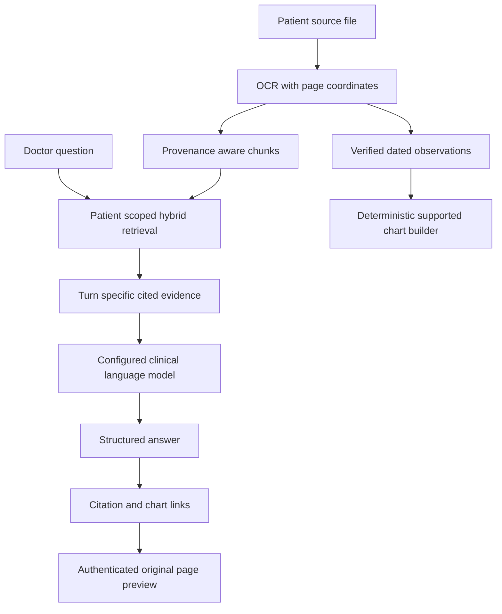

# AI, retrieval and evidence

## Provider routing

The deployed clinical language model is Sarvam `sarvam-105b`. The server selects the configured primary provider and validates structured output before accepting it. The Azure OpenAI adapter is configured as a secondary route, but Azure currently blocks the pilot model deployment with subscription restriction 715-123420. An Azure account or endpoint is not evidence of a running model; successful live Azure inference is not claimed until the restriction is resolved.

Azure AI Translator and Azure AI Speech are configured for translation and dictation. The application uses pinned multilingual E5-small embeddings executed on CPU. Provider routing, service-specific cooldowns and spending reservations are described in the [Azure operations guide](../../deployment/README.md#how-inference-is-routed).

## Evidence flow

## Retrieval augmented generation

OCR text is divided into provenance-aware chunks with patient, document, source name, page, date and normalized box metadata. Patient-scoped retrieval combines lexical matching, which is useful for exact values and names, with multilingual semantic similarity. Reciprocal rank fusion combines rankings. If semantic embedding retrieval is unavailable, lexical fallback remains possible and is reported as such.

Each ordinary chat turn retrieves evidence for that question. The model is instructed to cite factual statements, preserve source dates, avoid inventing values and state when the record does not contain an answer. Citation IDs must match the turn's evidence. The source viewer validates patient ownership, document and page before showing the original page and any supported highlight.

## Eight review stages

| Stage | Role in the review |
| --- | --- |
| Classification | Organizes documented diabetes status and its supporting context. |
| Trajectory | Reviews dated measurements across the available record. |
| Care gaps | Flags possible missing or overdue follow-up for review. |
| Mismatches | Surfaces conflicting record details for reconciliation. |
| Comorbidities | Summarizes relevant documented conditions beyond diabetes. |
| Caregiver preparation | Suggests understandable reminders based on documented context. |
| Assistive bubbles | Produces concise prompts for the consultation workspace. |
| Brief compiler | Validates and assembles the consultation brief. |

These stages organize evidence for the doctor. They do not establish a diagnosis, prescribe treatment or treat absent evidence as proof of absence.

## Diabetes review and chart scope

Diabetes-related review can use recorded diagnosis and type, HbA1c, fasting glucose, post-meal glucose, treatment and medication history, and relevant longitudinal context. The classifier is assistive rather than a complete diagnostic algorithm. A clinician must verify status against source records and clinical criteria.

Charts are built from verified dated observations for HbA1c, fasting glucose, post-meal glucose, eGFR, urine ACR, creatinine, LDL cholesterol, systolic blood pressure and diastolic blood pressure. The catalog retains dates, units, qualifiers and citations. Missing dates are not interpolated and values are not generated by the LLM. Other-condition requests can return source-linked summaries and tables. If a requested chart is outside the supported measurement catalog, the system should say so rather than fabricate a series.

## Translation, dictation and care plans

Azure AI Translator produces complete selected-language views for supported interface and pathway content. Protected clinical values are retained and incomplete translations are not treated as completed snapshots. The English signed pathway remains the archived clinical source; selected-language copies are derived downloads. Human review of clinical translation remains necessary.

Azure AI Speech supports doctor dictation. Audio is processed for transcription and returned as editable text before submission. Application storage does not retain microphone recordings. Speech-provider processing remains subject to its service terms and the deployed privacy policy.

## Limits

OCR quality varies by scan quality and layout. Retrieval can miss evidence; model output can be incomplete or wrong; semantic matching is not authorization; and a citation can support only the excerpt it identifies. Verify key findings in the original record. Live Azure OpenAI fallback is unavailable pending subscription approval. The deployment report records the observed OCR limitation, selected test exclusions and measured usage.
