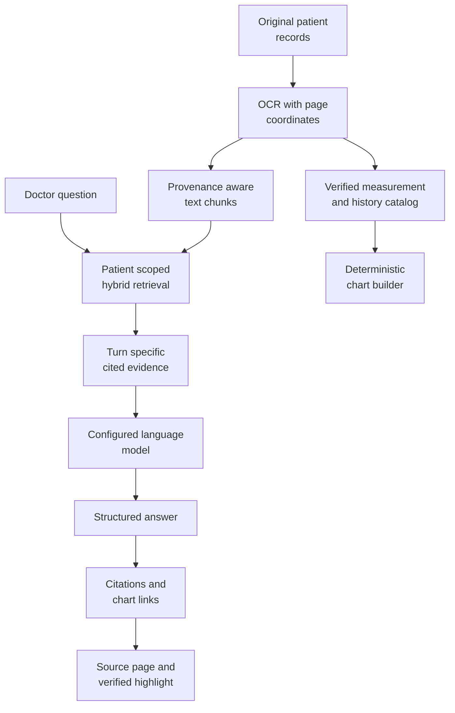

# AI, retrieval and evidence

The model provider boundary, RAG, review agents, supported measurements, charts, voice and limitations.

## Evidence to answer flow



The chart builder reads dated OCR measurements directly. It does not accept a model generated number as a chart observation.

## 5. Retrieval-augmented generation

### 5.1 Provenance-aware chunks

`ClinicalProvenanceChunker` turns stored patient documents into retrievable units. Metadata includes the patient, document, source filename, page, date/year, and bounding box. Laboratory rows are retained as useful atomic evidence where possible.

**Theory.** Retrieval works better when units are small enough to be relevant but large enough to preserve meaning. Provenance metadata connects each unit back to the original document.

**Clinical review use.** A medicine name, dosage disagreement, earlier admission, or exact laboratory result can be retrieved with its source rather than returned as an unsupported summary fragment.

### 5.2 Hybrid lexical and semantic search

The retriever combines BM25 and dense similarity using reciprocal rank fusion.

1. **BM25** helps with exact names, abbreviations, medicine strings, and numbers.
1. **Dense embeddings** help with related meanings and varied phrasing.
1. **Fusion** combines their rankings rather than assuming either method always finds the best evidence.

Retrieval accepts a patient scope and can apply date/category filters. The browser API first authorizes the patient; retrieval is not used as a substitute for access control.

If embedding generation or query embeddings fail, the implementation can continue with lexical retrieval. That fallback is reported; it is not a claim that semantic retrieval succeeded.

### 5.3 Conversation evidence

A conversational turn uses the patient's processed record catalog and, for ordinary questions, question-specific retrieval. Numbered citations are built for that turn.

The model is instructed to distinguish source dates from event dates, cite factual statements/table rows, avoid inventing values, and describe missing documentation honestly. Old conversation citation numbers must not be reused without matching the current evidence list.

The UI renders Markdown headings, emphasis, lists, and actual HTML tables. Numbered links open source evidence; saved chart links open the associated chart artifact.
## 6. The eight clinical review nodes

### 6.1 Classification agent

**Theory.** Classification maps retrieved evidence into a small set of record-review categories and produces a diagnostic-basis explanation. The actual prompt is [classification prompt](../../prompts/agents/classification_agent.yaml).

**Clinical review use.** The stage helps orient the consultation brief around documented glycemic status. It considers recorded diagnoses, HbA1c/glucose context, treatment history, and relevant type 1 history.

The current implementation is not a complete diagnostic algorithm. Its medication and keyword fallbacks can be misleading, and failed/empty model output can retain a default prediabetic label. The displayed classification requires clinician verification.

### 6.2 Trajectory agent

**Theory.** Longitudinal review compares observations across dated records, instead of treating the latest report as the entire patient history.

**Clinical review use.** This stage summarizes the recorded metabolic trajectory and produces key measurement context for the brief. It can help a doctor inspect how earlier and later results differ.

A generated trend is not proof of causality or deterioration. Units, dates, treatment changes, and the source record still matter. Numerical conversation charts use the verified OCR catalog rather than trusting model-generated series.

### 6.3 Care gaps agent

**Theory.** Gap review looks for missing, overdue, or unresolved items in the supplied record.

**Clinical review use.** It can surface documented screening/follow-up issues for review. An absent uploaded report is not automatically proof that a test was never performed.

This node has model-dependent behavior and fallback suggestions. The UI excludes unsupported gap claims rather than presenting every returned item as a confirmed patient fact. An existing live-model integration test that expects a specific foot-exam title has a known failure; see `TO_DO.md`.

### 6.4 Mismatches agent

**Theory.** Cross-document reconciliation searches for statements that disagree, particularly medicine names, doses, and continuation/discontinuation instructions.

**Clinical review use.** The doctor can compare conflicting prescription or discharge records before approving a plan.

A mismatch is a review question, not an instruction to select one dose. The application does not resolve medication discrepancies autonomously or transmit prescriptions to a pharmacy.

### 6.5 Comorbidities and clinical history agent

**Theory.** A focused diabetes workspace still needs relevant earlier events and other documented conditions. This stage identifies source-linked history outside the latest laboratory panel.

**Clinical review use.** Earlier admissions, procedures, other consultations, and recorded conditions can be brought into the doctor's review.

The API enriches history with the record catalog and validates citations. Template phrases such as “where applicable” should not become confirmed events without supporting documentation.

### 6.6 Caregiver preparation agent

**Theory.** Clinical communication translates a complex record into understandable preparation and observation reminders. It is different from diagnosis or prescribing.

**Clinical review use.** The prompt asks for 2–3 general reminders plus supported specific reminders when available, generally 4–5 items total. General reminders include bringing reports, medicines, existing requested logs, and questions. Specific reminders can quote exact supplied values, units, and dates within plain-language instructions.

The agent receives supplied measurement history, recorded conditions, medicine context, discrepancies, and allergy context. It may suggest discussing a documented change or bringing relevant discharge instructions. It must not invent a spike, heart condition, symptom, monitoring threshold, new testing frequency, or treatment instruction.

A higher recorded number alone is not automatically worsening. Comparisons require compatible dated values and units. When evidence is insufficient, the reminder should ask the care team what to watch for.

The suggestion agent requests English source instructions only. Care views derive English, Hindi, Tamil, Bengali, Odia, and Telugu text through the dedicated local IndicTrans2 worker; earlier chat-model translations are excluded from the current translation cache, and absent language fields are never filled with copied English. Translated clinical meaning still requires review. Revised prompting affects new suggestions; signed instructions are not retroactively rewritten.

### 6.7 Assistive bubbles agent

**Theory.** A short contextual question can help the reviewer discover another useful action without replacing the consultation.

**Clinical review use.** Suggested questions can lead to record history, a comparison, or a supported chart.

A prompt bubble is an invitation to inspect data. It is not evidence, a confirmed care gap, or proof that the suggested chart has already been generated.

### 6.8 Brief compiler

**Theory.** The compiler assembles outputs into the actual `ConsultationBrief` schema.

**Clinical review use.** It gives the browser a coherent representation of classification, trajectory, gaps, mismatches, caregiver preparation, priority findings, series, and prompts.

The API adapter then validates/enriches sources and catalog observations before the UI presents the brief. The repository's actual model is `ConsultationBrief`; older design examples with different names or arbitrary `cards[]` payloads are not the runtime contract.

A numeric freshness value in an agent schema is not a validated clinical freshness measure. The UI emphasizes source review rather than presenting that number as a clinical quality score.
## 7. Diabetes evidence and supported measurements

### 7.1 Classification evidence is not the chart whitelist

The classifier's current prompt uses these categories of information:

| Input | Implemented role |
| --- | --- |
| Recorded diagnoses and clinician impressions | Context for documented diabetes, prediabetes, IFG, or IGT. |
| HbA1c | The prompt uses `>= 6.5%` as diabetic-range evidence and `5.7–6.4%` as prediabetic-range evidence. |
| Glucose context | Retrieved fasting glucose and recorded IFG/IGT inform the review; the non-diabetic prompt rule includes fasting glucose `< 100 mg/dL` alongside absent history. |
| Diabetes medicine history | Supplies context, but a medicine mention alone is not verified proof of a diagnosis. |
| Documented type 1 / insulin dependence with DKA history | Additional type 1 context specified by the prompt. |

For clinical background, NIDDK describes HbA1c as reflecting average glucose over approximately three months and lists diagnostic testing ranges. It also explains that confirmation may be needed when symptoms are absent. These references describe clinical testing, not validation of PrepPulse's classifier: [The A1C Test & Diabetes](https://www.niddk.nih.gov/health-information/diagnostic-tests/A1C-test), [Diabetes Tests & Diagnosis](https://www.niddk.nih.gov/health-information/diabetes/overview/tests-diagnosis).

PrepPulse does not implement all diagnostic criteria, repeat-testing rules, assay limitations, medication indications, or differential diagnoses. Its category must not be used as an autonomous clinical decision.

### 7.2 Numerical chart scope

The chart whitelist contains **seven measurement families, represented as up to nine series**:

| Family | Series | Role in this application |
| --- | --- | --- |
| HbA1c | HbA1c | Review recorded glycemic measurements over time. |
| Glucose | Fasting glucose; post-meal glucose | Compare the corresponding recorded glucose series without treating them as interchangeable tests. |
| eGFR | eGFR | Review recorded kidney-related results in their source context. |
| Urine ACR | Urine ACR | Review recorded urine albumin/creatinine results. |
| Creatinine | Creatinine | Inspect recorded renal laboratory context. |
| LDL | LDL cholesterol | Inspect the supported lipid series. Other cholesterol fractions are not silently substituted. |
| Blood pressure | Systolic BP; diastolic BP | Compare recorded pressure components. |

Blood pressure, eGFR, urine ACR, creatinine, and LDL are monitoring/context measures here; they are not independent diabetes classification criteria.

The OCR catalog recognizes expected labels and source rows. Its supported-unit and plausibility rules are extraction constraints, not clinical treatment targets. It does not provide general unit conversion, understand every report layout, or guarantee extraction of all values in a difficult scan.

### 7.3 Chart requests and time windows

Explicit requests using **chart/charts, graph/graphs, plot/plots, visualize/visualise, visualization**, or the supported timeline/table phrasing go to the deterministic tool. A plural request must not fall through to a prose-only answer.

Examples:

```text
Can you generate me the charts for this patient?
Plot HbA1c for the last two years.
Visualise fasting glucose over the past 3 years.
Show eGFR between 2020 and 2023.
Plot it for me.
```

A short follow-up such as “plot it” can inherit the last relevant user topic. An explicitly supplied new period overrides an older period. Relative durations from **1 through 10 years** accept digits or English number words. They use a rolling window ending on the server's current date. Explicit calendar-year ranges are also supported.

The tool filters real observation dates; it does not merely change the chart title. The artifact records the requested period while its title reflects the dates actually represented. If the patient has only four years of data, a ten-year request does not create six extra years.

An ordinary diabetes/measurement question without an explicit chart request keeps its textual answer and offers a chart. An explicit request for no charts suppresses that offer.

Each successful request creates a new named artifact saved in the chat session. Chart and source links remain clickable after a session reload. Numerical chart generation does not depend on a working text model or embedding service.

### 7.4 Unsupported charts and evidence tables

Heart-disease, ejection-fraction, ECG, thyroid, HDL, weight/BMI, and other unsupported numerical chart targets must not trigger an unrelated HbA1c chart.

For an unsupported chart request, the assistant lists the actual supported measurements and explains that other documented conditions can still be reviewed as cited summaries or occurrence tables. Where matching OCR rows exist, it can return a table with source-record dates, recorded text/values, and source links.

A cardiac narrative or cholesterol occurrence table is not the same feature as a cardiac graph. A request for an unsupported topic as a table can return the table without claiming that a numerical chart was created.

Occurrence matching operates on processed, patient-owned OCR rows. It is not exhaustive medical concept recognition. The current table view shows up to 200 matching rows and explicitly reports when more matches exist; the full records workspace remains available.
## 12. Voice interaction

### Dictation

The browser records microphone audio after permission is granted. The UI shows an animated listening indicator and then a transcription indicator.

Local faster-whisper performs transcription, initially using `small` on CPU with INT8 computation. The transcript appears in the composer for correction; it is not automatically submitted.

The API enforces its audio-size limit and deletes its temporary recording after transcription. Browser microphone tracks stop when recording ends. The listening animation indicates recording state, not a medically validated speech-quality meter.

### Speech playback adapter

The browser Read aloud controls were removed from the current UI. The API retains an optional adapter for a local or private network service that returns WAV audio, but this adapter is not a current user facing feature.

The named `mradermacher/Qwen3-1.7B-Multilingual-TTS-GGUF` download is intended for speech synthesis, not transcription. A GGUF model appearing in an LM Studio text model list does not prove that an audio endpoint exists. The adapter requires a compatible `/v1/audio/speech` endpoint and does not execute the GGUF directly from `PREPPULSE_TTS_MODEL_PATH`.

## 14. Verification and known limits

Focused tests cover patient isolation, identity/backfilling, folder safety, appointment history, care revisions, preparation checks, sign-off, report permissions, source geometry, chart values, chart intent, and requested periods.

Browser tests use Microsoft Edge through Playwright. The isolated fixture uses synthetic records and in-memory MongoDB substitutes; its deterministic translations test UI/persistence mechanics, not live translation quality.

The live model can fail, time out, emit incomplete JSON, or produce a weak summary. Those outcomes must remain visible. In particular:

1. Classification fallbacks can be misleading and need clinician verification.
1. Source verification establishes location/ownership, not the truth of the medical claim.
1. A chart shows extracted observations, not a diagnosis, prognosis, treatment recommendation, or causal explanation.
1. OCR unit/layout support is limited; no general unit normalization is promised.
1. Narrative retrieval and occurrence tables can miss information when OCR fails or terminology differs.
1. Caregiver reports are self-reported completion, not verified administration.
1. Clinical translations and multilingual PDFs require review with the actual configured model.
1. Voice recording UI tests do not validate real microphone acoustics or transcription accuracy.
1. An existing live-agent test expects a specific foot-exam care-gap title and has a known failure; the care-gap implementation was not changed to force that output.
1. No automatic background reminders, hospital formulary, pharmacy integration, or production cloud deployment is included.

The [delivery tracker](../../TO_DO.md) records the current tested scope and outstanding review work.
