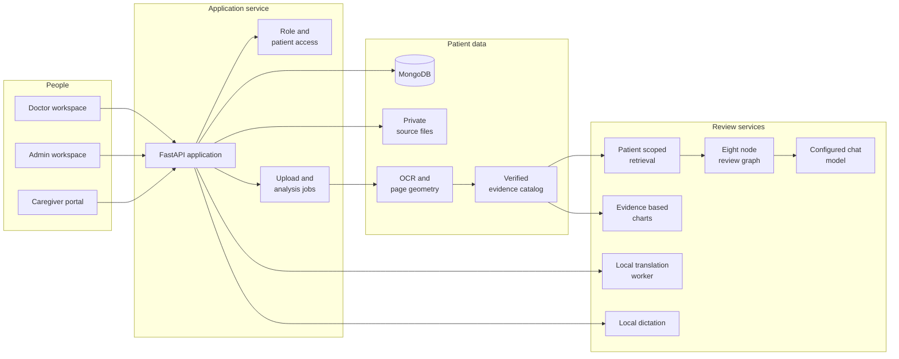
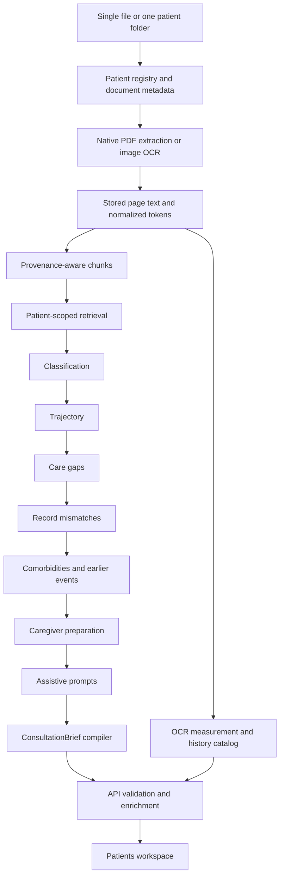

# PrepPulse architecture

How the browser, service, data store, source processing and clinical review workflow fit together.

## 2. Core design principles

### Patient identity outlives individual documents

Every patient receives an immutable PrepPulse ID. A dataset folder's ID is an external alias, not the internal database key. This allows a synthetic dataset and newly registered patients to coexist without competing for the same numbering sequence.

A patient can have many documents, visits, appointments, chat sessions, chart artifacts, and pathway versions. These objects retain their own identities while joining back to the same patient.

### A summary should lead back to evidence

Generated prose is useful only when the reviewer can inspect its basis. PrepPulse therefore carries document identity, page number, source text, and bounding-box information through extraction and retrieval.

A citation is not automatically trusted because an agent emitted one. The API attempts to locate the cited text in the owning patient's stored source. Where a precise span cannot be verified, the interface reports that limitation instead of drawing a misleading highlight.

### Measured values and model prose have different responsibilities

The language model can summarize the supplied record, explain relationships, and draft preparation reminders. The chart tool instead selects supported, dated measurements from OCR evidence.

The model does not invent chart coordinates, interpolate missing years, or populate a demonstration chart when a measurement is absent. A request for a nonexistent series produces a data gap.

### Clinician instructions and caregiver reports are distinct

A doctor's preparation checkbox is not evidence that someone administered medication. Caregiver-reported completion is a separate, attributed record.

Likewise, an unsigned draft is not the same object as an approved pathway. Signing creates a permanent version; later translations and follow-up reports do not silently rewrite the signed clinical instructions.

### Missing evidence must remain visible

An absent record is not proof that care was never delivered. A source date is not automatically a diagnosis date. A generic sentence in a template is not a confirmed patient event.

PrepPulse presents these distinctions in source states, historical snapshot notices, chart gaps, and clinician review controls.
## 3. System architecture

### Browser-to-service architecture

The browser calls `/api` routes. During development, Vite proxies those requests to the local Python API. The browser does not receive unrestricted filesystem access or connect directly to MongoDB.

The API resolves the authenticated account, applies role and patient-assignment checks, and then reads or changes the relevant records. Original file previews are served through authenticated routes rather than public static folders.

### Consultation pipeline

This is an eight-node review graph: seven specialized review/prompt stages and the final brief compiler. Chart creation and conversational question answering are separate API tools; they are not additional unnamed nodes in that graph.

### Analysis is a visible background operation

Uploads and analysis have job states. The UI can show queued/running/completed/failed status, processing stages, and document counts. An earlier brief can remain visible while a replacement is being generated.

The worker implementation runs in the API process. It is not a distributed task queue. Restarting the service can interrupt work; interrupted jobs become retryable rather than being evidence that processing completed.
