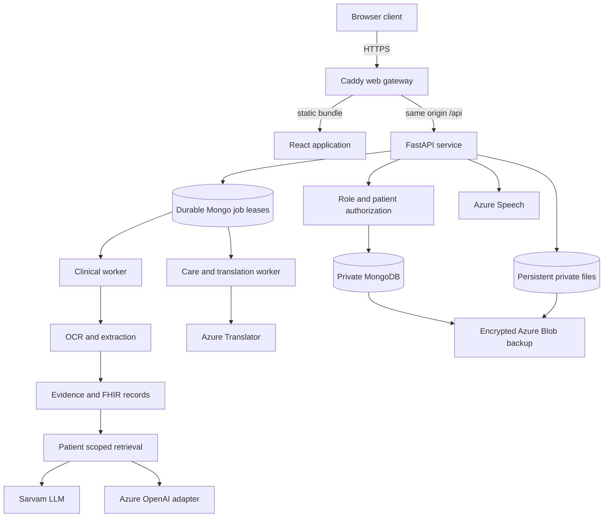

# Deployed architecture

## Runtime topology

The web client and API share one public HTTPS origin. Caddy serves the compiled client and forwards `/api` requests to FastAPI. The database and worker services are on a private Docker network and are not exposed as public ports.

## Request and evidence flow

An authenticated request is checked against the account role and patient assignment before patient data is returned. Uploads become private documents and durable processing jobs. Workers perform OCR, extraction, FHIR validation, indexing and clinical review. The browser polls job state and presents visible progress or failure. Chat requests retrieve patient-scoped evidence and attach source identifiers to the answer. Original pages are rendered only by authenticated patient-scoped routes.

## Persistence domains

MongoDB stores identities, account roles, appointments, documents, visit state, extracted observations, provenance, analysis jobs, chat sessions, chart artifacts, clinician decisions, signed pathways, caregiver reports and audit events. Private storage on the mounted managed disk holds originals, page renders, derived reports, translation snapshots and related files. E5 model weights are cached on the same persistent disk. Azure Blob stores encrypted backup archives.

Application containers can be recreated without recreating the persistent data disk. The API, clinical worker and care/translation worker are separate services. Durable leases and checkpoints allow interrupted tasks to be reported and retried. Remote inference is at least once: a worker interruption after a provider accepted a request can cause that call to be repeated.

## Trust and access boundaries

The browser does not receive filesystem paths or provider credentials. It uses authenticated routes. The API enforces role checks and doctor-to-patient assignments. Caregiver authorization is limited to an explicit patient and signed plan assignment. Admin access to operational data does not grant clinical brief access by default. MongoDB is private to the Compose network; public access terminates at the HTTPS gateway.

## Availability and capacity

The deployed pilot uses one Azure virtual machine and one clinical worker. It does not provide multi-region failover or a capacity guarantee for concurrent AI analyses. The live 10-active-flow login check is evidence for that bounded read workload only. Storage, model calls and provider rate limits remain operational constraints. See [release verification](../../deployment/VERIFICATION.md) for measured results and exclusions.
