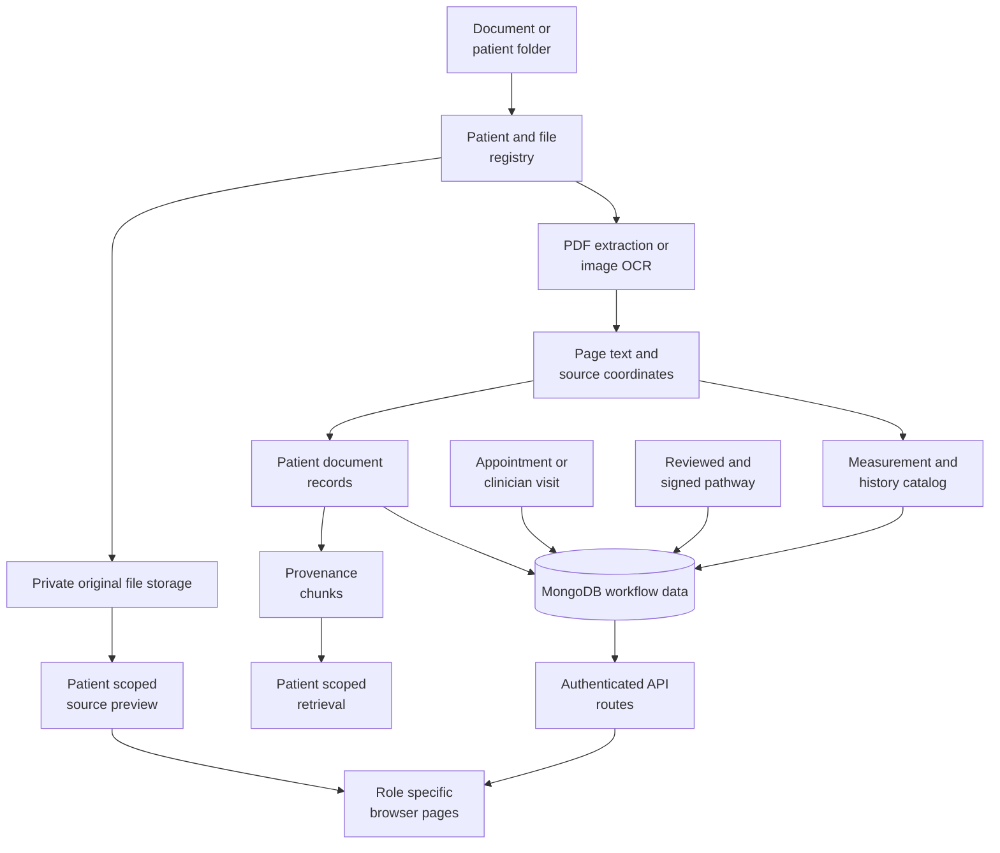

# Backend and data

Source ingestion, OCR, persistence, identity, access control, API contracts and FHIR oriented preprocessing.

## Document and visit data flow



MongoDB stores application records and workflow state. Original file bytes remain in private storage and are served only through patient scoped routes.

## 4. Source processing and preprocessing

### 4.1 Original records and private storage

The browser accepts clinical PDF, PNG, and JPEG files through the supported intake flows. A folder upload preserves all selected files privately; supported clinical documents are queued for processing, while auxiliary files are retained without being treated as clinical OCR evidence.

The folder importer validates relative paths, rejects traversal and ambiguous duplicate paths, and permits one patient root per selection. Current limits are 1,000 files, 30 MiB per file, and 250 MiB per folder selection. Single-document upload has its own API validation.

Unchanged relative-path/hash pairs are skipped. A changed file is retained as another version rather than silently replacing the earlier original.

### 4.2 OCR: text plus location

**Theory.** OCR converts visual document content into searchable text. Provenance-preserving OCR also records where the text came from. PrepPulse uses native PDF words when available and image OCR for scanned content. Tokens retain source geometry, confidence, and page membership.

**Clinical review use.** A result or prescription line can be inspected in the original page, including surrounding text that may change its interpretation. A reviewer need not trust an isolated extracted number without seeing the report.

The OCR layer includes line grouping and laboratory-table reconstruction. These operations improve downstream retrieval but do not guarantee that every scan, handwriting style, merged table cell, or unit is recognized correctly.

### 4.3 Normalized source geometry

Bounding boxes use `[x0, y0, x1, y1]` normalized to a 0–1000 coordinate system. For a rendered page with width `W` and height `H`:

```text
left   = x0 / 1000 * W
top    = y0 / 1000 * H
width  = (x1 - x0) / 1000 * W
height = (y1 - y0) / 1000 * H
```

This allows a citation to align with the page at different display sizes. A bounding box that surrounds an entire page does not provide the same precision as a verified result row. The API and UI therefore apply ownership, page, text-location, and span-size checks before offering a precise highlight.

### 4.4 Structured extraction and grounding

The repository also contains a Stage 2/3 preprocessing pipeline. It performs section-aware chunking, LLM-based fact extraction, terminology mapping, source grounding, review-queue handling, and FHIR-oriented output generation.

**Theory.** Structured extraction converts prose into entities such as measurements, medicines, diagnoses, vitals, and advice. Grounding then checks these proposed facts against source text and coordinates. Items that cannot be adequately grounded need human review rather than silent acceptance.

**Clinical review use.** Structured facts can support searches, comparisons, and interoperability experiments while preserving the clinician's ability to inspect the original wording.

The browser's current analysis path directly connects Stage 1 source documents, provenance chunking, retrieval, the review graph, and the OCR evidence catalog. The presence of the preprocessing/FHIR package does not mean every browser upload automatically executes or validates every Stage 2/3 operation.

### 4.5 FHIR-oriented output

The preprocessing package can assemble FHIR R4-style bundles from its grounded entities. This is an interchange-oriented representation of extracted data, not a claim of certified EHR integration.

There is no automatic hospital-system writeback, formulary integration, pharmacy transmission, or production interoperability certification in this release.
## 11. Identity, persistence, and access control

### Patient and folder IDs

An example folder `PP001_Ananya_Baruah` carries external code `PP001` and a full folder alias. PrepPulse assigns a separate `PRP-...` patient ID.

Names are not unique identifiers. Alias collisions with another patient are rejected rather than silently merging two people. Selecting an existing patient before uploading additional files is the preferred repeat-intake workflow.

### Main data groups

| Data | Typical collection or storage |
| --- | --- |
| Accounts and staff identity | `users`, `staff_directory` |
| Patient identity and doctor access | `patients`, `patient_aliases`, `patient_access` |
| Uploaded file/version metadata | `workspace_files`, `workspace_documents` |
| OCR and staged document content | `patient_documents`, `document_chunks` |
| Consultation outputs and jobs | `briefs`, `jobs` |
| Scheduling and encounters | `appointments`, `visits` |
| Review decisions | `review_decisions` |
| Draft/signed care instructions | `care_drafts`, `pathways`, legacy `pathway_items` |
| Clinician preparation checks | `care_visit_checks` |
| Caregiver access and follow-up | `caregiver_access`, `care_reports`, `care_notes` |
| Legacy signed translations (not used for current display) | `care_translations` |
| Per-language derived text and progress | `care_language_cache` |
| Validated, reusable text translations, scoped to a patient and model version | `care_segment_cache` |
| Conversation persistence | `chat_sessions`, `chat_messages`, `chat_turns`, `chat_artifacts` |
| Access/change events | `audit_events` |
| Original private files/PDFs | Ignored private storage on disk |

The browser integration adds indexes idempotently. A source record and a historical snapshot have different lifecycles: editing present-day demographics does not rewrite a signed patient snapshot.

### Role boundaries

| Capability | Doctor | Admin | Caregiver |
| --- | --- | --- | --- |
| Clinical brief and chat | Assigned patients | No default clinical access | No |
| Register patients / manage accounts | No | Yes | No |
| Upload patient records | Assigned patients | Yes | No |
| Schedule appointments | Read own schedule | Manage | No |
| Edit/sign care plans | Assigned clinical visits | No | No |
| View signed caregiver instructions | Assigned patients | No default clinical access | Assigned patients |
| Report caregiver completion / notes | Read reports | Manage assignment only | Assigned signed plans |

Authentication uses hashed passwords and signed HTTP-only sessions. Mutating API requests require the CSRF token supplied by authentication. Patient ownership/assignment is checked by server routes, not merely hidden in the navigation.

This local configuration does not provide a complete production security program. TLS termination, managed secrets, disk/database encryption, backup policy, organizational governance, and shared-host deployment controls need an environment-specific design.
## 13. Implementation layout and contracts

| Path | Responsibility |
| --- | --- |
| `web/src/App.tsx` | Workspace shell, selection, navigation, patient/admin page composition. |
| `web/src/PatientConversation.tsx` | Saved conversation UI, source/chart interaction, microphone status, transcript review. |
| `web/src/ChartArtifactView.tsx` | Rendering saved numerical/event artifacts and source-linked points/tables. |
| `web/src/RecordWorkspace.tsx` | Full source record browsing, pages, search, and citations. |
| `web/src/CareChecklist.tsx` | Simple Patients checklist and three-item card presentation. |
| `web/src/CareWorkspace.tsx` | Clinician editing, sign-off, signed-plan review, and caregiver portal interactions. |
| `web/src/VisitHistory.tsx` | Appointment history and saved visit/record sections. |
| `web/src/UnifiedIntake.tsx` | Combined demographics and file/folder intake. |
| `web/src/AccountsAdmin.tsx` | Account creation and search. |
| `web/src/CaregiverAdmin.tsx` | Assignment and caregiver availability roster. |
| `web/src/AdminPatientDetails.tsx` | Directory editing and patient administrative record views. |
| `src/preppulse_api/app.py` | Authentication, route composition, jobs, visits, conversations, voice routes. |
| `src/preppulse_api/clinical.py` | Browser analysis adapter, source rendering, citation validation, brief enrichment. |
| `src/preppulse_api/chart_intent.py` | Deterministic chart intent, context, metric selection, and date windows. |
| `src/preppulse_api/chat_service.py` | Conversation evidence, response orchestration, chart artifacts, scope handling. |
| `src/preppulse_api/chat_tables.py` | Cited OCR occurrence tables for other documented topics. |
| `src/preppulse_api/evidence_catalog.py` | OCR measurement series and source/history catalog. |
| `src/preppulse_api/care.py` | Drafts, translations, signed pathways, reports, tasks, and PDFs. |
| `src/preppulse_api/administration.py` | Runtime contract, administrative metadata, historical adapters. |
| `src/preppulse_ocr` | OCR foundation and geometry. |
| `src/preppulse_db` | Document schemas and MongoDB adapters. |
| `src/preppulse_preprocessing` | Structured extraction, grounding, terminology and FHIR-oriented pipeline. |
| `src/preppulse_rag` | Provenance chunking, hybrid retrieval and model providers. |
| `src/preppulse_agents` | Typed review state, specialized agents and graph compiler. |

The current runtime compatibility contract is `preppulse-ui-care-4` at `GET /api/runtime`. Interactive API schemas are available from the running FastAPI service at `/docs`.

The browser's persisted conversation flow uses `/api/chat/sessions` and asynchronous turns. A legacy `/api/chat/query` route also exists; it is not the complete saved-chart conversation contract.

Request and response shapes are defined by the FastAPI contracts. The running service exposes its interactive OpenAPI schema at `/docs` for exact payload details.
