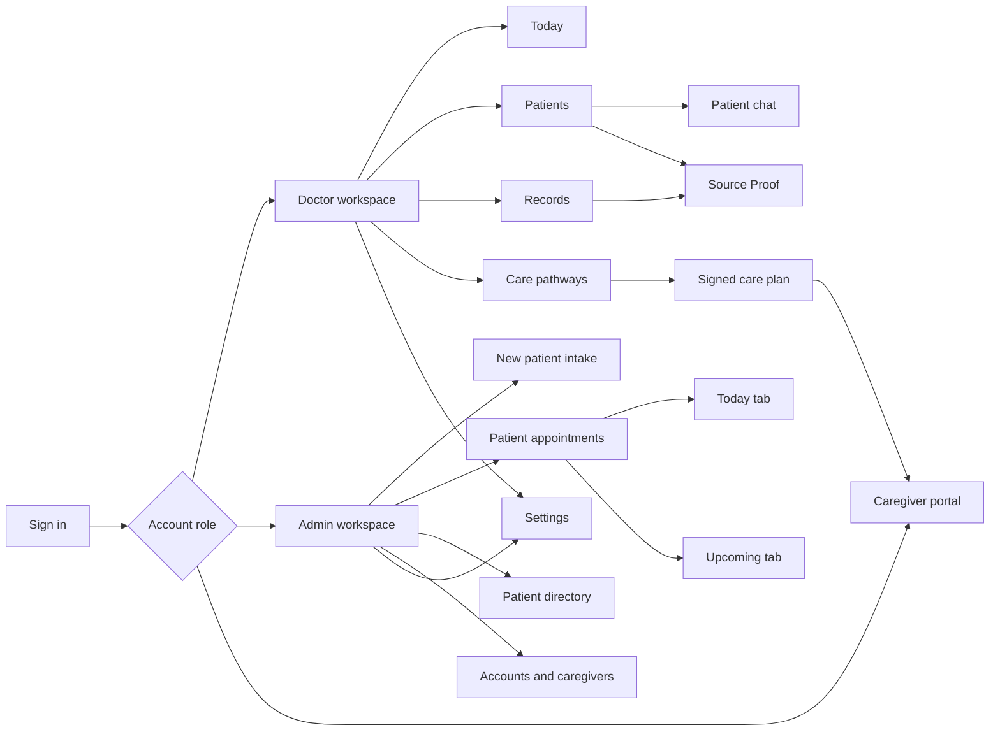

# Frontend guide

Doctor, administrator and caregiver workspaces, page behavior, interactions and frontend integration.

## Frontend navigation and page flow

The page descriptions below explain each role’s entry point and the patient context shared by the related views.

## 8. Doctor workspace: page-by-page guide

### Patients

Patients is the doctor's main consultation workspace. Select an assigned patient by name, permanent PrepPulse ID, or external folder alias. The selected patient's identity remains visible in the workspace context.

The page contains a consultation brief, the four principal cards, visit focus/measurement context, priority findings, relevant history, and the collapsible right rail.

1. **Metabolic trajectory:** current measurement context with source-linked comparisons.
1. **Care gaps:** confirmed source-backed items, with a visible empty state when none are established.
1. **Record mismatches:** discrepancies requiring clinician reconciliation.
1. **Family / caregiver pathway:** up to three checklist items, prioritizing doctor-written/edited instructions.

The main actions include starting a visit, analyzing records, uploading records, changing admission state, and reviewing/signing the pathway. Accept/Edit/Reject decisions are stored for the active visit.

**Analyze records** processes pending supported documents and reruns the review pipeline. It is an explicit action, with processing stages and counts. It does not grant permission to invent findings when evidence is missing.

The right rail places **PrepPulse Assistant** first, **Source Proof** second, and the **Visit checklist** below them. Each section can collapse. The entire rail can hide so the brief uses the available width.

The checklist panel is intentionally simple: checkboxes, a language selector, a small **Edit pathway** link, and a selected-language download for the latest signed plan. Text editing and prescribing live on Care pathways.

### Today

Today shows the signed-in doctor's current-day appointments as browsable patient cards. Cards include scheduling and available demographic context. Selecting a patient opens Patients.

Appointments are refreshed by polling. This is near-real-time synchronization, not a WebSocket subscription. Missing demographic data is shown as missing rather than inferred from a name.

### Records

Records brings together assigned patient cards, appointment-history search, dated visit links, source documents, and previous signed caregiver pathways.

Search supports patient name/ID and date. The existing dropdowns and collapsible sections remain available. The separate Previous patients menu has been removed because historical review belongs here.

Selecting a visit opens saved visit information and available sign-off snapshots. An older visit without a snapshot is labeled accordingly. Earlier clinical state is not reconstructed from today's brief and presented as an original historical fact.

The visit links use larger text for readability. **Browse patient records** opens the full source workspace.

### Appointment history workspace

The expanded history workspace provides filters and a vertically browsable appointment list. It is a separate workspace with a Back action, rather than a narrow nested overlay.

The history list is newest first and contains no edit/delete actions. Completed appointments from today can appear in previous history. Opening a linked historical consultation preserves source/chat access while hiding active-visit editing controls.

### Source Proof / Record workspace

Source Proof displays the selected original page and, when verified, its precise OCR highlight.

Expanding opens a larger record workspace with selectable file tiles, page navigation, record search, and original-page viewing. A source filename is not the same thing as a verified claim: a result must still match the cited document, patient, page, and text span.

If the exact span cannot be located, the page can remain inspectable while the UI clearly reports that precise highlighting is unavailable.

### Chat workspace

The dedicated chat workspace uses the available browser width and can show chat on the left with an interactive chart or selected source on the right.

Chat and chart panels can collapse independently. Closing the inspector returns space to the conversation. Source Proof does not open merely because a source exists; it opens from relevant interaction such as a citation click or an explicit source request.

Conversations have saved sessions, messages, chart artifacts, and processing stages. The doctor can start another session or return to an earlier one for the selected patient.

Replies support headings, emphasized values, tables, source links, and chart links. Source documents are uploaded through Patients or intake, not attached through the chat composer.

### Care pathways

Care pathways is the full clinician editing and approval workspace. Checklist items appear as checkbox rows first. A nearby **Edit** link reveals text, frequency, and removal controls; **Done editing** restores the simpler row.

Doctors can append instructions, write notes, and enter prescriptions/treatments. Names and doses remain free text because there is no institutional medicine catalog in this release. Schedule controls cover start date, days/months, duration, dose-time slots, and food timing. A plus action adds another medication or treatment.

Admission selects caregiver mode; non-admission uses family mode. The card title in Patients remains **Family / caregiver pathway**, avoiding an incorrect fixed family label.

Edits autosave with revision checks. Conflicts should be reviewed rather than overwriting another window. The UI preserves unfinished work across its supported navigation paths by flushing draft edits before switching views.

### Settings

Doctor Settings provides browser-local appearance and accessibility preferences plus dictation-language selection. Read aloud controls were removed from the browser; the API audio adapter remains optional but is not exposed as a current user feature.

Light/Dark/System appearance, text size, and contrast affect presentation. These preferences are local to the browser/account rather than MongoDB-synchronized institutional settings.

The navigation rail can collapse across screens. The movable assistant bubble remains available on appropriate non-Patients pages.
## 9. Admin workspace: page-by-page guide

### New patient intake

Intake is a combined registration and record-upload workflow. Enter name, DOB or recorded age, sex, and doctor assignment; upload a document or one patient folder, or register first and append files later.

For an existing patient, select that patient before adding records. Repeat visits should reuse the same permanent patient identity.

A recorded age does not manufacture a birth date. Demographics entered by the administrator remain separate from agent inference.

The UI shows selected/saved/unchanged counts, processing stages, document counts, and failures. Folder upload is a real file ingestion flow rather than a registry-only sample import.

### Patient appointments

The first row contains **New appointment** and **Today's appointments**. The second row contains **Find previous appointments** and the scrollable history list.

Name/ID search can be combined with an exact date, or used without one. Date-only search is also supported. The doctor sees assigned scheduling changes on the next refresh.

Admins can create, edit, or cancel scheduling entries through the active scheduling controls. The historical list remains a review view without edit/delete actions.

Starting a consultation can link the matching appointment; completing/signing the visit completes that linked appointment. Unscheduled visits still retain a visit ID.

### Patient directory

The directory presents patient cards and retains doctor-assignment controls. Opening a card displays administrative details, document states, appointments, and visit context.

Administrators can edit demographics, browse all records by default, filter by visit/date, add records, preview files, and edit document metadata. Display-title changes do not replace original source bytes or filenames. Signed pathway dates/types remain immutable.

The directory refreshes records and processing counts, including new signed pathway PDFs. Administrative access does not include the doctor's clinical brief or private conversation workspace by default.

### Accounts

Accounts is the single place for creating doctor, admin, family-caregiver, and professional-caregiver accounts. There is no public signup.

Search supports name, username, public account ID, or internal ID. Accounts can be disabled; the current account cannot disable itself through that action.

Public account IDs distinguish roles:

| Prefix | Account type |
| --- | --- |
| `ADM-` | Administrator |
| `DOC-` | Doctor |
| `FAM-` | Family caregiver |
| `HCW-` | In-hospital / professional caregiver (new accounts) |

Existing internal `user_id` values remain unchanged. The non-secret `staff_directory` mirror supports staff identity/status tracking without duplicating password hashes.

Selecting **Caregiver** in Accounts reveals a required **Family caregiver / In-hospital caregiver** choice; new accounts have no implicit family default. Existing `CGV-` professional IDs remain valid. An administrator can correct an existing caregiver's type in Account directory: this issues the corresponding `FAM-` or `HCW-` public ID, retains the old ID as a searchable alias, and revokes current patient assignments so the administrator can assign the appropriate patients again. Login credentials, internal identity, historical reports and notes are preserved. The change does not automatically classify existing family accounts as hospital staff.

### Caregivers

The left panel assigns an already registered caregiver to a patient. The caregiver's registered family/professional type must match the assignment.

Choose the caregiver type, then use either the search fields or the dropdowns. A unique exact name, username, public/internal account ID or old-ID alias resolves the caregiver; a unique patient name, PrepPulse ID or folder alias resolves the patient. A unique partial result also resolves automatically. Ambiguous names require selecting a matching result; the application never chooses between people with the same name. Dropdown selections populate the search fields. Roster search is independent of the assignment search.

The right panel is a searchable caregiver roster with administrator-maintained **Free** and **Active** availability. Availability is separate from account enablement and patient access.

Account creation does not appear here; it stays in Accounts. Access can be revoked without deleting the patient's signed plans.

### Settings

Admin Settings includes the shared browser appearance/accessibility preferences and appointment start-time/step defaults. These are convenience defaults, not an automated scheduling engine.

Database configuration and model connection secrets are not editable patient-facing settings. They remain local service configuration.
## 10. Caregiver portal and continuity of care

### My care plans

A caregiver signs into the same PrepPulse address and receives a single-page **My care plans** workspace. Access is limited to patients assigned by an administrator.

Family caregivers see only signed family pathways; in-hospital caregivers see only signed caregiver pathways. The server checks both patient assignment and account/pathway type for listing, reading, translation requests, downloads, completion reports and notes. Neither type obtains access to the other's pathway merely by knowing its ID.

The portal displays approved instructions, scheduled tasks, supported-language rendering, downloads, and a place for caregiver notes. It does not expose raw clinical source files, unsigned drafts, clinical briefs, doctor chats, or appointment history.

### Clinician preparation checks

Active-visit preparation ticks are stored separately from clinical text revisions. The main card, lower checklist, and pathway checkbox view share that saved state.

These checks do not change translation revisions or create caregiver administration reports. They are labeled as clinician preparation.

### Signed instructions and caregiver-reported completion

Sign-off saves a pathway version, approving clinician/time, patient snapshot, available brief snapshot, and source-document membership. It ends the active draft/visit and appends an English PDF to patient Records. For instructions entered in another supported language, the immutable original remains stored in the signed pathway; the English derivative is archived after its translation completes.

Caregiver completion reports are attributed and timestamped. A daily task has its own date/slot identity. Future completion is rejected. Past calendar-day tasks without a completion report can be flagged; this does not prove a dose was missed or that a completed checkbox proves administration.

A later signed plan supersedes the old schedule going forward. Earlier reports and notes remain available for review.

### Multilingual rendering and PDF downloads

Supported care languages are English, Hindi, Tamil, Bengali, Odia, and Telugu. The selected language is shared across the current patient's checklist/card/editor views.

Text edits invalidate stale translations. The selected-language checklist/notes/prescription view becomes available only when all required text has been translated and validated. Pending or failed work shows a translated status and retry controls; it does not mix translated rows with English fallback rows. The clinician can switch to the source language to inspect or edit the original.

Switching language requests only that language automatically. Fixed care controls/headings switch immediately; checklist instructions, doctor notes and dose/application text use **AI4Bharat IndicTrans2**, running entirely on the same PC in an isolated Ubuntu WSL2 environment. The Windows API starts a persistent worker over local stdin/stdout pipes on first use. It has no network listener, hosted inference provider, translation API key, or connection to the LM Studio chat model. English→Indic and Indic→English use separate pinned official models; Indian-language→another Indian-language edits pass through English. CPU inference is the default installation; CUDA is an optional setup choice. The first uncached request takes model processing time. The worker stays loaded for later requests, and the views poll progress until the complete version is available. Card and lower checklist share the same patient language and saved preparation/completion state.

Medicine names and the signed source dose remain exactly as entered. Dose/application instructions have a separate translated display copy, with the source available in the prescription table tooltip. The worker protects numbers, recognized units and biomarker abbreviations through IndicProcessor entity handling, then restores and checks them. Long text is split to fit the model, never silently truncated. An English copy in a non-English slot is rejected. Each language is cached by model version, draft/signed identity, text revision and source hash in `care_language_cache`. Validated segments are also cached per patient in `care_segment_cache`, so editing one instruction can reuse translations of unchanged instructions. Successful segments survive a failed batch internally but remain hidden until the complete snapshot is ready. Signed text, checklist IDs, medication schedules and completion reports are never rewritten by translation.

Care interface labels, buttons, schedule labels and completion captions have fixed translations for all six supported languages. The caregiver portal heading/navigation and patient action labels follow the selected patient's language too. Names, medicine names, user-written caregiver notes and identifiers remain source text. Clinical translation requires fluent review: script/number checks and a successful model run do not establish correct clinical meaning.

Signed-plan PDFs paginate and remain downloadable in the selected language when a complete translation is available, including localized headings and schedule labels. An incomplete translation returns an explicit unavailable response. Downloads do not replace the English patient-record archive or substitute the current draft into a previously signed plan.
