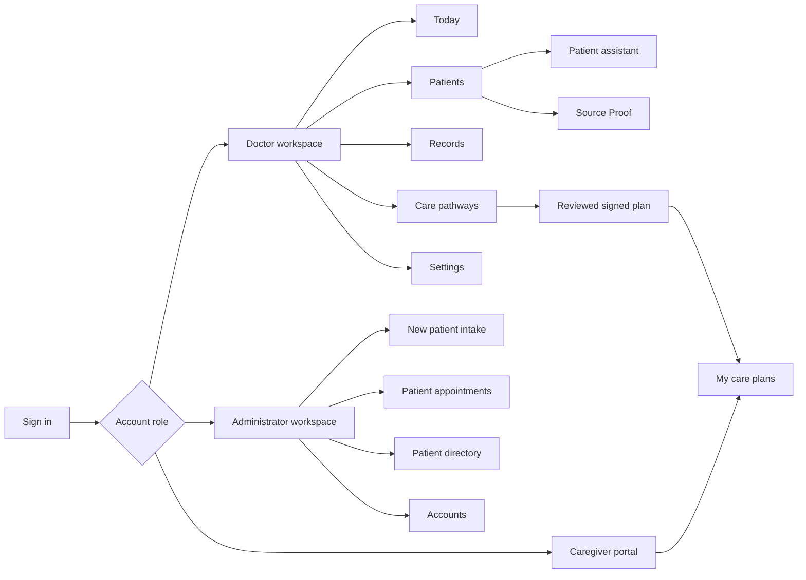

# Frontend guide

The deployed browser application is built with React, TypeScript, Vite and Recharts. It provides separate doctor, administrator and caregiver workspaces while retaining consistent patient identity and navigation context.

## Navigation map

## Doctor workspace

**Patients** is the main consultation page. It shows selected patient identity, a structured brief, dated metabolic context, other documented history, source-linked priority findings, the assistant, Source Proof, and the family or caregiver checklist. Doctors can analyze records, upload a document, start or end a visit, review findings and open a pathway for editing. The compact checklist view is read-only; pathway editing and prescribing happen in Care pathways.

**Today** presents appointments for the current date. Selecting an appointment opens the patient workspace. **Records** provides assigned patients, earlier visits, original documents, signed pathways and prior appointment history. A historical visit does not pretend that today's brief is a saved historical snapshot when no such snapshot exists.

**Care pathways** contains editable clinician instructions, checklist entries, notes and medication schedules. Language selection controls the translated view and downloadable copy. The English signed archive remains the permanent clinical record. Signing requires explicit clinician action.

**Settings** contains display preferences and dictation language preference. Microphone dictation returns editable text before a doctor submits it to the assistant.

## Administrator workspace

**New patient intake** registers a person and supports first or later document intake. **Patient appointments** provides scheduling, Today and Upcoming views, date filtering and previous-appointment search. **Patient directory** supports demographic and assignment management plus patient-associated records. **Accounts** manages doctors, administrators and caregivers, caregiver type and patient access. Administrative screens do not expose clinical brief content by default.

The new-appointment form finds patients by name, permanent PrepPulse ID or external folder alias, including records beyond the first directory page. It selects a unique match automatically and requires an explicit dropdown choice for ambiguous matches. The patient directory has the same API-backed search. Caregivers can search their assigned care-plan cards by name or ID; the patient-scoped API does not expose other patients.

## Caregiver portal

The caregiver sees the signed plans assigned to their account, chooses an available language, reviews instructions and prescription schedules, marks daily checklist work and shares a note. Reported completion and notes are persisted for the doctor to review. The caregiver cannot access the doctor's unrestricted patient workspace.

## Responsive behavior and interaction states

The interface adapts to browser width. On narrow portrait screens, navigation uses a horizontally browsable top menu; desktop uses a collapsible side menu. Logout is available in navigation as well as the desktop profile control. Jobs, translation, empty results and unavailable evidence have visible states. The application polls appointment and job status; these are near-real-time refreshes rather than a WebSocket guarantee.

The frontend communicates with the API over same-origin `/api` routes. It never receives raw source paths. Source links use document identifiers and page numbers, and the backend authorizes each preview request before serving it.
